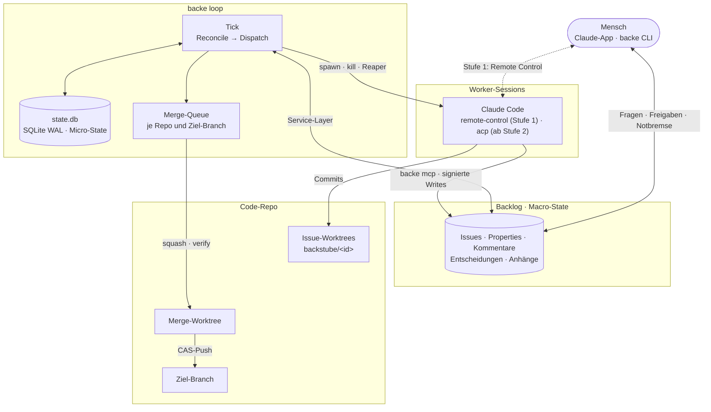
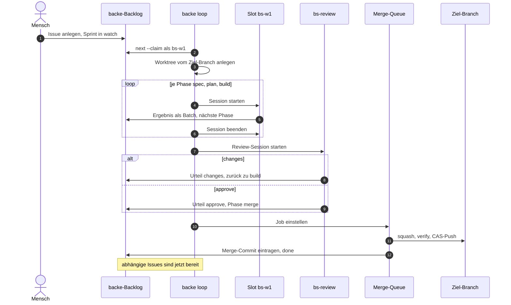
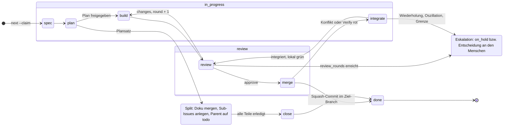
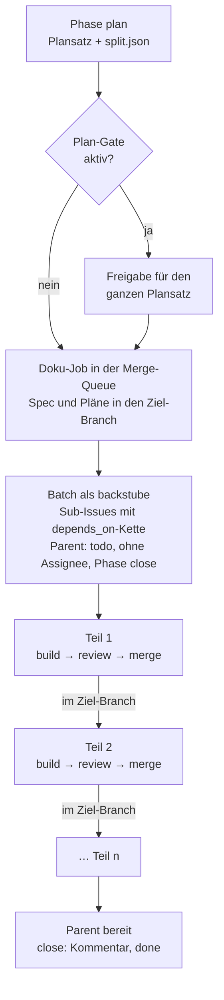
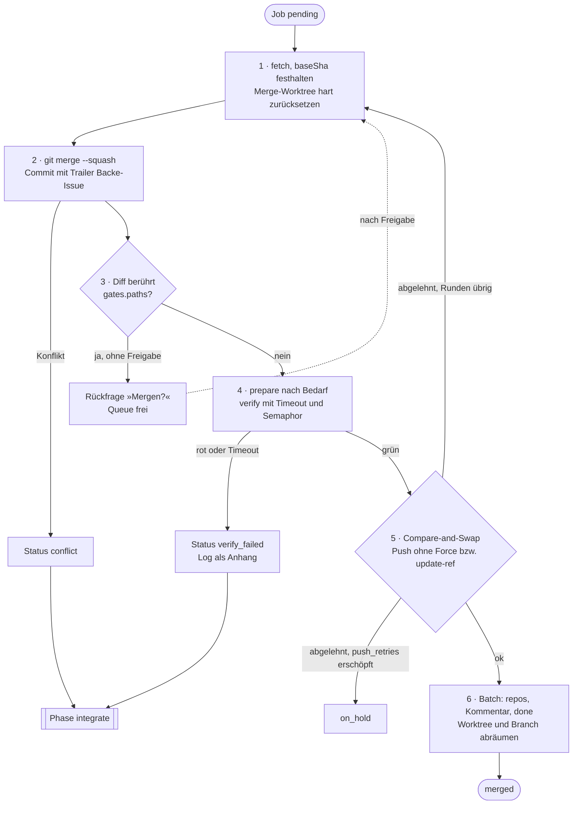
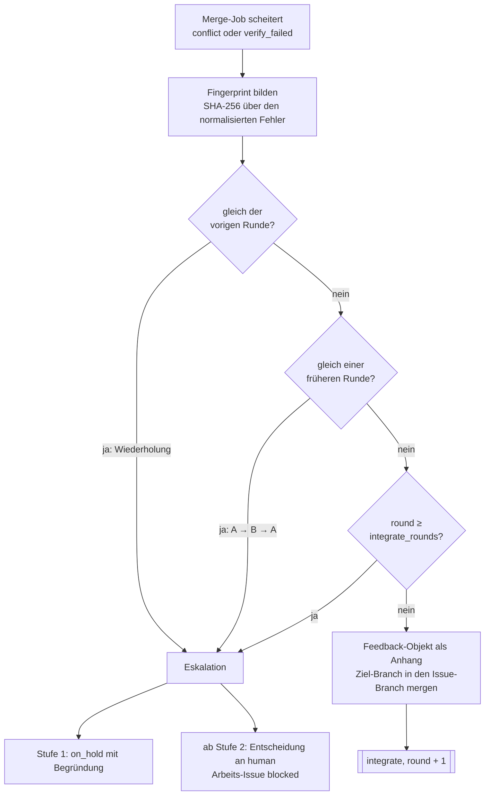
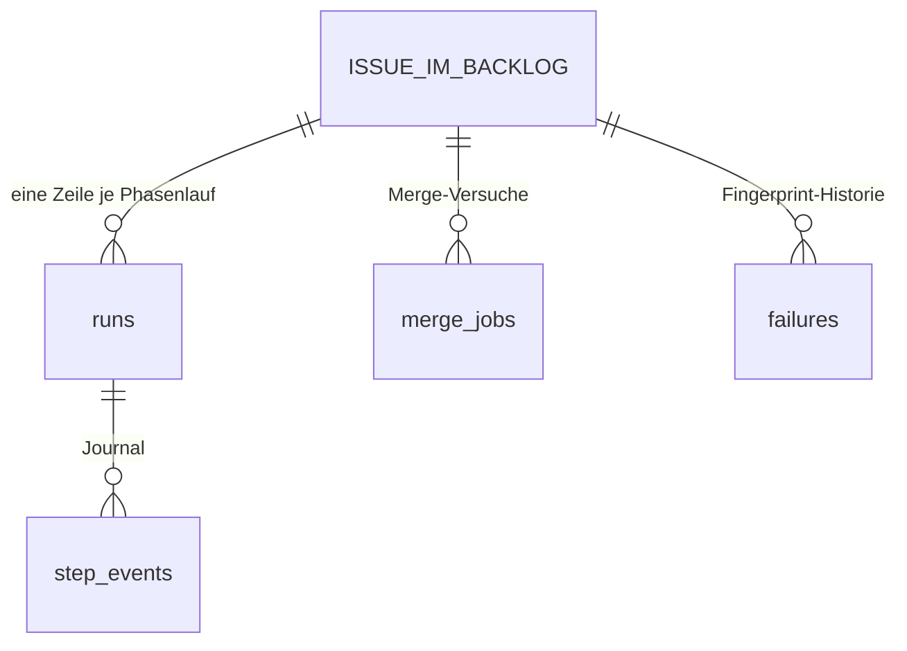
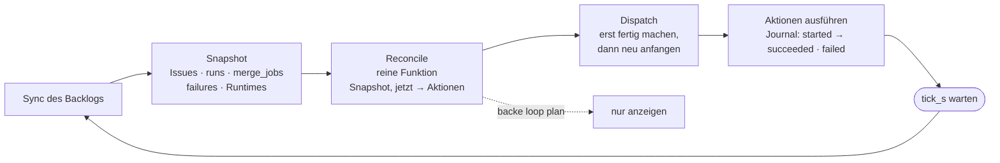
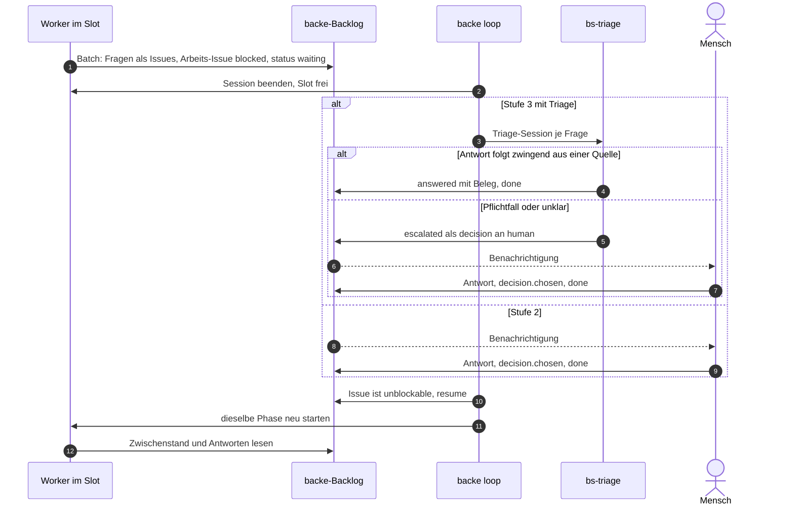
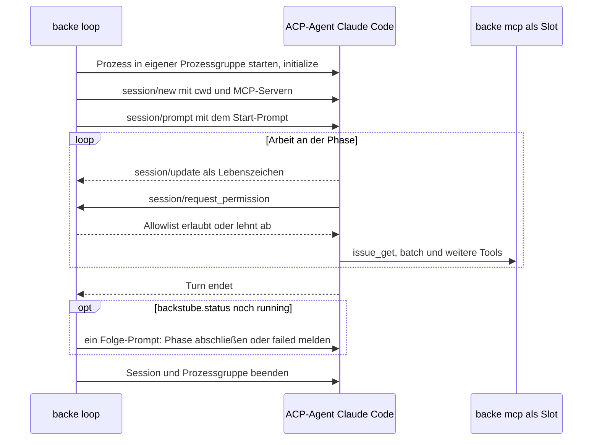

# Backstube — Software-Factory auf `backe`

> **Status: Entwurf.** Noch nicht umgesetzt; offene Entscheidungen in §4.1.
> Ort: Befehl `backe loop` im Paket `@spearwolf/backe` (§2.14).
> Bezug: baut auf BK auf (`backe.md`), vor allem BK §2.6 (Zustandsmodell), §2.12 (Identität), §2.16.5 (Claim), §2.16.6 (Batch), §2.19 (MCP), §2.22–§2.24 (Bereitschaft, Sub-Issues, Properties) und §2.25 (Entscheidungen als Issues).

## 0. Problem & Abgrenzung

### 0.1 Problem

Ein `backe`-Backlog enthält Arbeit, die Coding-Agents erledigen können. Heute startet ein Mensch jede Session von Hand: Er wählt das Issue, öffnet den Worktree, ruft den passenden Skill auf und reicht den Kontext durch. Die Arbeit des Menschen besteht damit zum größten Teil aus Disposition, nicht aus Entscheidungen.

Die **Backstube** übernimmt die Disposition. Sie überwacht freigegebene Sprints und Projekte, zieht bereite Issues, lässt jedes davon phasenweise von Agent-Sessions bearbeiten (bei Superpowers: Spec → Plan → Build → Review) und merged das Ergebnis selbst in den Ziel-Branch, bevor abhängige Issues starten. So setzt sie ganze Sprints und Backlogs um, nicht einzelne Branches. Welcher Harness eine Phase bearbeitet (Claude Code, Codex CLI, Gemini CLI, OpenCode), ist Konfiguration. Den Menschen holt sie nur dort dazu, wo er gebraucht wird: bei Rückfragen, Freigaben und Eskalationen. Sie ist Teil von `backe` und läuft als `backe loop`; wer keine Fabrik betreibt, ruft den Befehl nie auf und merkt nichts von ihm.

Der Name: In der Backstube wird gebacken (BK, »Der Name«).

### 0.2 Ziele

- **Ein deterministischer Orchestrator.** Welches Issue als Nächstes dran ist und welche Session läuft, entscheidet Code anhand des Backlog-Zustands, kein Sprachmodell (§3.1).
- **Zwei Zustandsebenen.** Was Menschen sehen und entscheiden, steht im Backlog (Macro-State). Wie die Backstube es gerade ausführt, steht in einer lokalen SQLite-Datenbank (Micro-State). Bei Widerspruch gewinnt das Backlog (§2.1, §3.17).
- **Durable Execution ohne Infrastruktur.** Jeder Schritt der Backstube steht vor und nach seiner Ausführung in SQLite (WAL). Nach einem Absturz setzt sie am letzten konsistenten Punkt fort, ohne Server, ohne Docker, als ein Node-Prozess (§2.9, §3.14).
- **Eine Phase je Session.** Jede Session bearbeitet genau eine Phase eines Issues und hinterlässt ihr Ergebnis in `backe` und im Branch. Sessions sind damit austauschbar, und ein Absturz kostet höchstens eine Phase (§3.4).
- **Harness- und modellagnostisch.** Die Backstube steuert Harnesses über das Agent Client Protocol (ACP) an und gibt ihnen Werkzeuge über MCP mit, allen voran den MCP-Server von `backe` (§2.11, §3.15). Referenz-Harness der ersten Version ist Claude Code mit Superpowers; weitere Harnesses kommen ohne Umbau dazu (§4.2). Stufe 1 nutzt Claude Code mit Remote Control, weil nur dort der Rückkanal zum Handy existiert (§2.10.1).
- **Fertig heißt gemergt.** Ein Issue ist erst `done`, wenn sein Code im Ziel-Branch liegt und dort die Verifikation des Repos besteht. Die Backstube merged selbst, seriell über eine Merge-Queue je Ziel-Branch, in einem eigenen Merge-Worktree (§2.6). Abhängige Issues starten damit auf einem Stand, der ihre Abhängigkeiten enthält.
- **Keine Endlosschleifen.** Harte Rundengrenzen, Fingerprints von Fehlern und eine Oszillationserkennung beenden wirkungslose Fix-Runden früh und eskalieren sauber an den Menschen (§2.7).
- Jede Rückfrage erreicht den Menschen mit einer Benachrichtigung auf dem Handy. In Stufe 1 bleiben die Rückfragen interaktiv in der Session (§2.10.1), ab Stufe 2 werden sie zu Issues (§2.10.2), und in Stufe 3 sortiert eine Triage vor, was wirklich nur der Mensch entscheiden kann (§2.10.3).
- Jeder Write ist einer Rollen-Identität zurechenbar (BK §2.12): Orchestrator, Worker-Slot, Reviewer, Triage.
- Nicht jedes Issue braucht Superpowers. Ein Issue wählt per `backstube.workflow` seinen Workflow, also die Folge seiner Phasen, die Skills darin und den Harness je Phase (§2.5.1).
- Superpowers wird unverändert genutzt. Die Anpassungen an den Factory-Betrieb liegen in einem eigenen Skill, der davor sitzt (§2.8).
- Jede Session startet im richtigen Verzeichnis des richtigen Repos, damit der Harness dessen Kontext lädt: Projekt-Anweisungen, repo-lokale Skills, Settings, Hooks und MCP-Konfiguration (§2.5.3). Ein Repo ist optional; Workflows ohne Code-Bezug laufen in einem Scratch-Verzeichnis.
- **Evolutionsfähig.** Die erste Version läuft auf einem Host. Claim und Merge sind so gebaut, dass mehrere Hosts später dieselben Git-Mechanismen als verteiltes Compare-and-Swap nutzen, ohne zentrale Workflow-Datenbank (§4.2).

### 0.3 Nicht-Ziele (erste Version)

- Kein Deploy. Auto-Merge in den Ziel-Branch gehört zum Fundament (§2.6); was danach ausgeliefert wird, entscheidet die Pipeline des Repos.
- Ein Host. Mehrere Backstuben auf demselben Backlog sind späterer Ausbau (§4.2).
- Keine Workflow-Engine als Server (Temporal, Restate) und kein Agent-Framework als Runtime, auch nicht Hermes (§3.2, §3.14).
- Keine Sandbox. Agents laufen als lokale Prozesse im Worktree; ob und wann Container kommen, ist offen (§4.1).
- Kein eigenes Paket und kein eigenes Repo. Die Backstube ist der Befehl `backe loop` in `@spearwolf/backe` und nutzt dessen Service-Layer direkt (§2.14, §3.3). Was sie darüber hinaus vom Kern braucht, steht als Wunsch an BK in §4.2.
- Keine eigene UI. Der Mensch arbeitet mit der Claude-App, dem `backe`-CLI und `backe loop status`; eine Ansicht in `backe ui` folgt später (UI §4.3).

### 0.4 Anti-Ziele

Das Projekt ist gescheitert, auch wenn alles technisch funktioniert, wenn …

- … der Mensch Pull Requests einzeln mergen muss. Die Backstube ist keine PR-Factory; ein PR pro Issue ist kein Ergebnis, sondern liegen gebliebene Arbeit;
- … ein Issue `done` ist, dessen Code nicht im Ziel-Branch liegt, oder ein Issue auf einem Stand startet, der seine erledigten Abhängigkeiten nicht enthält;
- … ein Merge den Checkout verändert, in dem ein Mensch arbeitet;
- … ein Agent denselben Fehler ein drittes Mal zu fixen versucht oder zwischen zwei Fehlern hin- und herpendelt, statt zu eskalieren;
- … der Mensch täglich mehr als eine Handvoll Pings bekommt, die er ohne Nachdenken beantwortet. Solche Fragen gehören in die Triage, in eine Regel oder in die Permission-Allowlist;
- … eine Triage-Antwort Arbeit in eine Richtung lenkt, ohne dass das im Backlog nachvollziehbar ist;
- … man das Log eines Sprachmodells lesen muss, um zu verstehen, warum die Backstube Issue X gestartet hat;
- … ein Issue nach einem Absturz still auf `in_progress` liegen bleibt.

## 1. Ist-Zustand

- **`backe` 0.5** liefert die Bausteine: synchroner Claim mit genau einem Gewinner unter synchronisierenden Clients (BK §2.16.5), `next --ready`-Semantik samt `depends_on` und Sub-Issues (BK §2.22, §2.23), `blocked`/`resume` und `issue list --unblockable` (BK §2.6), deklarierte Properties (BK §2.24), atomare Batches (BK §2.16.6), Anhänge (BK §2.8) und das Muster »Entscheidungen sind Issues« (BK §2.25). `backe mcp` stellt dieselben Operationen als MCP-Server über stdio bereit, mit der Identität aus `--as` oder `BACKE_USER` (BK §2.14, §2.19). Einen Daemon hat `backe` bewusst nicht (BK §3.8). `backe loop run` ändert daran nichts: Es ist ein Vordergrundprozess wie `backe mcp` und `backe ui`, den der Mensch startet, auf Wunsch als systemd-User-Unit.
- **Superpowers** bringt die Skills mit, die die Backstube braucht: `brainstorming`, `writing-plans`, `using-git-worktrees`, `subagent-driven-development`, `test-driven-development`, `systematic-debugging`, `requesting-code-review`, `verification-before-completion` und `finishing-a-development-branch`. Sie sind **interaktiv** ausgelegt: `brainstorming` stellt dem Menschen Frage für Frage und reicht am Ende selbst an `writing-plans` weiter; `finishing-a-development-branch` fragt, ob gemergt, ein PR geöffnet, der Branch behalten oder verworfen werden soll. Spec und Plan landen als Dateien im Code-Repo (`docs/superpowers/specs/`, `docs/superpowers/plans/`). Superpowers liefert neben Claude Code auch Anpassungen für weitere Harnesses mit, darunter Codex.
- **Claude Code** läuft interaktiv oder headless (`claude -p`). Über Remote Control ist eine lokale interaktive Session in der Claude-App erreichbar, auch auf dem Handy, mitsamt Benachrichtigung, sobald sie auf Eingabe wartet. Eine Headless-Session hat keinen Rückkanal zum Menschen. Den Projektkontext lädt Claude Code aus dem Arbeitsverzeichnis: `CLAUDE.md` (auch aus übergeordneten Verzeichnissen) und `CLAUDE.local.md`, unter `.claude/` Skills, Subagents, Settings und Hooks, dazu projektbezogene MCP-Server aus `.mcp.json`. Neue Verzeichnisse verlangen beim ersten Start eine Vertrauensbestätigung, Projekt-MCP-Server eine Freigabe.
- **Agent Client Protocol (ACP)** ist ein offenes JSON-RPC-Protokoll über stdio zwischen einem Client (ursprünglich Editoren, hier die Backstube) und einem Agent-Prozess: Der Client legt eine Session mit Arbeitsverzeichnis und MCP-Servern an, schickt Prompts, empfängt Fortschritts-Updates und beantwortet Permission-Anfragen. Native Unterstützung oder Adapter gibt es nach Angaben der Hersteller für Claude Code, Gemini CLI, Codex CLI und OpenCode; in diesem Proposal ist davon noch nichts gegen eine konkrete Version geprüft; für Claude Code prüft es F2 (§2.11.2).
- **SQLite in Node:** Node 26.13.1 lädt `node:sqlite` (SQLite 3.54.1) ohne Flag und ohne Warnung (geprüft per `node -e`). Eine eingebettete Datenbank im WAL-Modus kostet damit keine native Abhängigkeit.
- **Projektkontext je Harness:** Jeder Harness liest seine eigenen Dateien. Claude Code `CLAUDE.md`, Codex CLI und OpenCode nach eigener Doku `AGENTS.md`, Gemini CLI `GEMINI.md` (für die drei letzten ungeprüft). Wo eine Session startet, entscheidet also bei jedem Harness, was sie kann und weiß.

## 2. Soll-Zustand

### 2.1 Überblick



**Macro-State im Backlog.** Phase, Status, Versuche, Session-Link, Ergebnisse, Rückfragen, Eskalationen und der Merge-Commit stehen als `backe`-Writes am Issue. Worker melden ihr Ergebnis ausschließlich darüber und über den Branch. Die Backstube wertet von einer Session nur technische Signale aus: lebt der Prozess, und wie endete der Prompt-Turn. Den Inhalt einer Session parst sie nie.

**Micro-State in SQLite.** `<BACKE_HOME>/loop/<backlog>/state.db` hält, was nur die Ausführung auf diesem Host betrifft: laufende Runs mit Prozess-Handles und Heartbeat, das Journal aller Schritte (`step_events`), die Merge-Jobs samt Basis- und Ergebnis-Commit, und die Fingerprints früherer Fehler. Geht die Datenbank verloren, baut die Backstube Runs und Queues aus Backlog und Runtime wieder auf (§2.9.4); verloren ist dann nur die Fehlerhistorie, nicht die Arbeit.

**Ein Issue im Durchlauf** (Workflow `superpowers`, ohne Rückfragen):



### 2.2 Rollen und Identitäten

Alle Rollen sind Agent-Identitäten mit dem Menschen als `operator`, angelegt per `backe user create-agent` (BK §2.12).

| Handle | Rolle | Schreibt |
| --- | --- | --- |
| `backstube` | Orchestrator und Merge-Queue | Split in Sub-Issues und Abschluss `close` (§2.5.5), `resume`, Recovery-Moves, Zähler und Status bei Abstürzen, Eskalationen, `on_hold` bei erschöpftem Budget, Feedback-Anhänge, `done` nach dem Merge |
| `bs-w1` … `bs-wN` | Worker-Slots | Claim (`next --claim --as bs-wK`), Ergebnisse aller Phasen, die der Workflow nicht dem Reviewer zuweist |
| `bs-review` | Reviewer | Urteil der Phasen mit `role: reviewer` |
| `bs-triage` | Triage (Stufe 3) | Antworten oder Eskalationen auf Fragen |

**Slot gleich Identität.** Der Assignee eines Issues sagt, welcher Slot es hält. Darüber gleicht die Backstube Issues mit laufenden Sessions ab, ohne Lease in `backe` (§3.5). Die Zahl der Keys bleibt dadurch auf die Zahl der Slots begrenzt. Ein Slot kann mehrere Issues halten (eins in Arbeit, weitere in `review`, `blocked` oder in der Merge-Queue), aber nur eine Session gleichzeitig. Die Kapazität zählt Sessions, nicht Issues. Dass `backe next` das eigene laufende Issue zuerst liefert (BK §2.22), passt zur Regel »erst fertig machen, dann neu anfangen« (§2.9.3).

**Harness ist keine Identität.** Ob `bs-w1` gerade über Remote Control oder über ACP läuft, und später mit welchem Harness, ändert nichts an der Zurechnung: Signiert wird mit dem Key des Slots, den die Backstube der Session über `BACKE_USER` und den mitgegebenen `backe mcp` setzt (§2.11.3). Welcher Harness eine Phase bearbeitet hat, steht in `backstube.harness` und im Ergebnis-Kommentar.

### 2.3 Konfiguration

Host-lokal je Backlog unter `<BACKE_HOME>/loop/<backlog>/config.jsonc` (§3.9). Welches Backlog, löst `backe loop` wie jeder Befehl auf (`-B`, Kontext, BK §2.14); daneben liegen `state.db`, `worktrees/` und `scratch/`. Ein JSON Schema entsteht wie bei den übrigen Configs aus dem zod-Schema (BK §2.20).

```jsonc
{
  "watch": [                          // Reihenfolge = Priorität beim Dispatch
    { "sprint": "2026-w48" },
    { "project": "web/auth", "level": "top" },  // level wie bei backe next (BK §2.23)
    { "project": "ops", "workflow": "direct" }, // Default-Workflow dieses Eintrags
    { "sprint": "2026-w49", "target": "sprint" }  // Integrations-Branch je Sprint (§2.6.1)
  ],
  "target": "default",                // default (default_ref des Repos) | sprint
  "merge": { "strategy": "squash", "via": "git" },  // §2.6.3, §2.6.5
  "workflow": "superpowers",          // globaler Default-Workflow
  "workflows": { /* eigene Workflows und Overrides der eingebauten, §2.5.1 */ },
  "harness": "claude-rc",             // Default-Harness für Phasen ohne eigene Angabe
  "harnesses": {                      // §2.11
    "claude-rc":  { "runtime": "remote-control" },
    "claude-acp": { "runtime": "acp", "command": ["<ACP-Adapter für Claude Code>"] }
  },
  "repos": {                          // je backe-Repo-Name, alles optional (§2.5.3, §2.6.2)
    "webapp": {
      "local_files": ["CLAUDE.local.md", ".claude/settings.local.json"],
      "prepare": { "run": ["pnpm install --frozen-lockfile"], "when_changed": ["pnpm-lock.yaml"] },
      "verify": ["pnpm lint", "pnpm test"],  // Pflicht für Auto-Merge
      "keep": ["node_modules", ".cache"],    // bleibt beim Reset des Merge-Worktrees liegen
      "add_dirs": []
    }
  },
  "slots": ["bs-w1", "bs-w2", "bs-w3"],
  "reviewer": "bs-review",
  "triage": null,                     // Stufe 3: "bs-triage"
  "questions": "interactive",         // interactive (Stufe 1) | issues (ab Stufe 2, Pflicht für acp)
  "human": "spw",                     // Empfänger von Entscheidungen
  "gates": {
    "plan": false,                    // Plan-Freigabe im Workflow superpowers (§2.5.2)
    "sprint": false,                  // Freigabe je Sprint-Merge (§2.6.1)
    "paths": ["**/migrations/**", "pnpm-lock.yaml", ".github/workflows/**"]  // §2.6.5
  },
  "worktrees": "<BACKE_HOME>/loop/<backlog>/worktrees",  // Default, überschreibbar
  "ports": { "base": 41000, "span": 100 },   // §2.12
  "limits": {
    "attempts": 2,                    // gescheiterte Versuche je Phase (Absturz, failed)
    "review_rounds": 3,               // Rückweisungen im Review je Issue
    "integrate_rounds": 3,            // Fix-Runden nach Konflikt oder rotem Verify je Issue
    "push_retries": 3,                // abgelehnte Pushes je Merge-Job
    "split_parts": 12,                // höchstens so viele Sub-Issues je Split (§2.5.5)
    "phase_timeout_min": 240,
    "verify_timeout_min": 30,
    "verify_concurrency": 1,          // gleichzeitige Verify-Läufe über alle Queues
    "tick_s": 60
  },
  "session_title": "{id} · {phase} · {title}"
}
```

**Opt-in:** Die Backstube fasst nur Issues an, die einem `watch`-Eintrag entsprechen. Ob ein Repo nötig ist, sagt der Workflow (§2.5.1): Fehlt es bei einem Workflow mit `repo: required` oder liefert `backe repo where` keinen lokalen Pfad, bekommt das Issue einen Kommentar mit dem Hinweis auf `backe repo scan` und geht auf `on_hold`. Einzelne Issues lassen sich per `backstube.skip: true` ausnehmen.

**Workflow eines Issues:** `backstube.workflow` am Issue, sonst `workflow` des passenden `watch`-Eintrags, sonst der globale `workflow`.

**Harness einer Phase:** `backstube.harness` am Issue, sonst `harness` der Phase im Workflow, sonst der globale `harness`. Ein Harness mit `runtime: acp` ist nur mit `questions: "issues"` zulässig, weil er keinen Rückkanal zum Menschen hat; `backe loop doctor` lehnt die Kombination mit `interactive` ab.

### 2.4 Properties

Deklariert in `backlog.jsonc` (BK §2.24), alle unter dem Präfix `backstube.`:

| Property | Typ | Bedeutung | Setzt |
| --- | --- | --- | --- |
| `backstube.workflow` | string | Workflow des Issues (§2.5.1); fehlt sie, gilt der Default aus der Config | Mensch, beim Anlegen oder später |
| `backstube.phase` | string | aktuelle Phase, gültig sind die Phasen des Workflows sowie `integrate` und `close`; fehlt sie, gilt dessen erste Phase | Worker beim Abschluss; Backstube bei `integrate`, `close` und Rücksprüngen; Mensch, um später einzusteigen (ein Bug mit klarem Repro startet in `superpowers` bei `plan`) |
| `backstube.harness` | string | Harness für alle Phasen dieses Issues, überschreibt Workflow und Config | Mensch |
| `backstube.plan` | string | repo-relativer Pfad des Plans, den dieses Issue umsetzt; fehlt sie, sucht die Session den Plan im Branch | Backstube beim Split (§2.5.5); Mensch |
| `backstube.repo` | string | Haupt-Repo, wenn `repos` mehrere Einträge hat; sonst gilt der erste (§2.5.3) | Mensch |
| `backstube.dir` | string | Unterverzeichnis im Repo als Arbeitsverzeichnis, etwa ein Paket im Monorepo (§2.5.3) | Mensch |
| `backstube.status` | enum `running`, `waiting`, `done`, `failed`, `stalled` | Zustand der Phase | `running`: Backstube beim Start; `done`, `failed`, `waiting`: Worker; `stalled`: Backstube bei Timeout |
| `backstube.attempts` | integer | gescheiterte Versuche der aktuellen Phase | Backstube |
| `backstube.round` | integer | Zähler der laufenden Schleife: Rückweisungen im Review bzw. Fix-Runden in `integrate` | Backstube |
| `backstube.session` | string | Session-Name bzw. Link zur Remote-Control-Session | Backstube |
| `backstube.target` | enum `default`, `sprint` | Ziel-Branch dieses Issues, überschreibt die Config (§2.6.1) | Mensch |
| `backstube.merge` | enum `auto`, `manual` | `manual`: vor dem Merge eine Freigabe einholen (§2.6.5) | Mensch, Triage, Backstube bei `gates.paths` |
| `backstube.pr` | string | URL des PRs, nur bei `merge.via: github-pr` | Backstube |
| `backstube.gate` | enum `none`, `plan` | überschreibt `gates.plan` für dieses Issue | Mensch |
| `backstube.skip` | boolean | Issue nicht anfassen | Mensch |
| `backstube.asked_by` | string | ab Stufe 2: Issue, dessen Arbeit die Frage gestellt hat | Worker |
| `backstube.route` | enum `answered`, `escalated`, `invalid` | Stufe 3: Ergebnis der Triage | Triage |

`backstube.workflow`, `backstube.phase` und `backstube.harness` sind bewusst `string` statt `enum`: Welche Workflows und Harnesses es gibt, steht in der Host-Config, nicht im Backlog (§3.10). Die Backstube prüft die Werte beim Dispatch; ein unbekannter Wert führt zu `on_hold` mit Begründung. Den Branch trägt das eingebaute Feld `repos` (`webapp@backstube/bk-7f3k2`), nach dem Merge den Merge-Commit (`webapp@3e1f9a2`, wie in BK §2.25). `kind` (`question`, `decision`) folgt der Konvention aus BK §2.25 und wird nicht als Enum deklariert, weil die Audit-Skills `kind` mit eigenen Werten belegen.

### 2.5 Workflows und Lebenszyklus

#### 2.5.1 Workflows

Ein Workflow ist eine benannte, geordnete Liste von Phasen. Er legt fest, welche Phasen ein Issue durchläuft, wer sie ausführt, mit welchem Harness, welche Skills die Session nutzen soll und wo sie startet. Superpowers ist ein guter Workflow für Feature-Arbeit mit offenem Design, für einen Dependency-Bump oder eine Textkorrektur aber reine Zeremonie.

```jsonc
"workflows": {
  "direct": {
    "repo": "required",               // required | optional | none
    "cwd": "worktree",                // worktree | repo | scratch (§2.5.3)
    "phases": [
      { "name": "build",  "skills": [], "state_after": "review" },
      { "name": "review", "role": "reviewer", "skills": [], "model": "<stärkstes Modell>" },
      { "name": "merge",  "role": "backstube" }
    ]
  }
}
```

Je Phase: `name`, `role` (`slot`, Default; `reviewer`; `backstube` für die Merge-Phase, die ohne Session und ohne Sprachmodell läuft, §2.6.3), `skills` (Namen, die der Start-Prompt der Session nennt; leer heißt, die Session nutzt, was Repo und Host mitbringen), optional `harness`, `model`, `state_after` (backe-State nach erfolgreichem Abschluss) und `gate` (Rückfrage zur Freigabe am Ende, §3.8). Bei »changes« eines Reviewers springt das Issue in die Phase davor zurück. Jeder Workflow, der Code ändert, endet mit `merge`; die Backstube lehnt Workflows mit `cwd: worktree` ohne `merge`-Phase ab.

Zwei Phasen gibt es in jedem Workflow, ohne dass er sie nennt: `integrate` (Rückkopplung aus der Merge-Queue, §2.6.4) und `close` (Abschluss eines aufgeteilten Issues, §2.5.5).

**Eingebaute Workflows.** Die Backstube bringt drei mit, die Config kann sie überschreiben oder eigene hinzufügen:

| Workflow | Phasen | `repo` | `cwd` | Wofür |
| --- | --- | --- | --- | --- |
| `superpowers` | `spec` → `plan` → `build` → `review` → `merge` | required | worktree | Features und Änderungen mit offenem Design (§2.5.2) |
| `direct` | `build` → `review` → `merge` | required | worktree | kleine, klar umrissene Änderungen: Chores, Bugs mit klarem Repro, Bumps. Arbeitet nach den Konventionen des Repos, ohne Superpowers. Das Review bleibt, weil es ohne PR das einzige zweite Augenpaar ist |
| `task` | `run` | optional | repo bzw. scratch | Arbeit ohne Branch und ohne Merge: Recherche, Analysen, ein Audit mit einem repo-lokalen Skill, Text im Backlog. Ergebnis als Kommentar, danach `done` |

Jedem Workflow lässt sich `intake` als erste Phase voranstellen (§2.5.4). Ein eigener Workflow für die Audit-Skills aus BK §2.25 wäre etwa `audit` mit einer Phase `run`, `skills: ["js-ts-project-audit"]` und `cwd: repo`. Der Skill liegt im Code-Repo unter `.claude/skills/` und ist deshalb nur in einer Session verfügbar, die dort startet (§2.5.3).

**Workflow wechseln:** Der Mensch ändert `backstube.workflow`, solange keine Session für das Issue läuft. Gibt es die aktuelle Phase im neuen Workflow nicht, setzt die Backstube auf dessen erste Phase zurück und schreibt das als Kommentar.

#### 2.5.2 Workflow `superpowers`

| Phase | Identität | Superpowers-Skills | Artefakt | Erfolg → |
| --- | --- | --- | --- | --- |
| `spec` | Slot | `brainstorming` | Spec unter `docs/superpowers/specs/` im Branch, Kurzfassung als Kommentar | `plan` |
| `plan` | Slot | `writing-plans` | ein Plan oder ein Plansatz unter `docs/superpowers/plans/` im Branch; bei mehr als einem Plan das Manifest `split.json` als Anhang | ein Plan: `build`; Plansatz: Split (§2.5.5); bei aktivem Gate jeweils erst nach der Freigabe |
| `build` | Slot | `subagent-driven-development` (darin `test-driven-development`), `systematic-debugging`, `verification-before-completion` | Commits im Branch | `review`; State → `review` |
| `review` | `bs-review` | `requesting-code-review`, `verification-before-completion` | Urteil als Kommentar | »approve« → `merge`; »changes« → `build`, State → `in_progress`, `round + 1` |
| `merge` | `backstube` | keine, Merge-Queue (§2.6.3) | Squash-Commit im Ziel-Branch | `done`; bei Konflikt oder rotem Verify → `integrate` (§2.6.4), State → `in_progress` |



Die äußeren Kästen sind die `backe`-States, die inneren die Phasen. Ein Plansatz verlässt die Hauptlinie über den Split; jedes Sub-Issue durchläuft danach selbst `build` → `review` → `merge` (§2.5.5).

- **States:** Der Claim setzt `in_progress` (BK §2.16.5); `spec`, `plan` und `build` laufen darin. `build` endet mit `review`. Eine Rückweisung im Review geht zurück auf `in_progress`, das erlaubt die Hauptlinie ohne `workflow.strict` (BK §2.6). Während `merge` bleibt das Issue auf `review`; scheitert der Merge, geht es mit `integrate` zurück auf `in_progress`. `done` setzt die Backstube im selben Batch, der den Merge-Commit einträgt.
- **Worktree:** `superpowers` arbeitet mit `cwd: worktree` (§2.5.3). Spec und Plan liegen dort als Dateien; jede neue Session findet so die Arbeit der vorigen.
- **Overrides:** Der Workflow gibt `backstube-worker` drei Superpowers-spezifische Regeln mit: `brainstorming` reicht nicht von sich aus an `writing-plans` weiter, die Phase endet mit der committeten Spec; `using-git-worktrees` entfällt, denn der Worktree existiert schon; `finishing-a-development-branch` entfällt, denn gemergt wird ausschließlich über die Merge-Queue.
- **Review-Unabhängigkeit:** Der Reviewer ist eine eigene Identität in einer frischen Session, wahlweise mit einem anderen Modell als der Build. Er sieht Spec, Plan und Diff, aber nicht den Verlauf der Build-Session.
- **Review-Schleife:** Erreicht `round` den Wert `limits.review_rounds`, eskaliert die Backstube statt eines weiteren Builds (§2.7.4).
- **Plan-Gate:** Ist das Gate aktiv, stellt die `plan`-Session am Ende die Frage »Plan freigeben?« mit den Optionen Freigeben, Überarbeiten (mit Hinweis) und Abbrechen. Bei einem Plansatz gilt die Freigabe für den ganzen Satz, nicht je Plan. Das Gate ist eine gewöhnliche Rückfrage und folgt dem Modus aus `questions` (§3.8).
- **Plansatz:** Schreibt `writing-plans` mehrere aufeinander aufbauende Pläne, wird jeder Plan ein eigenes Sub-Issue mit eigenem Build, Review und Merge (§2.5.5). Ein Issue setzt höchstens einen Plan um.

#### 2.5.3 Arbeitsverzeichnis und Projektkontext

Jeder Harness lädt seinen Projektkontext aus dem Arbeitsverzeichnis (§1). Die Backstube bestimmt es deshalb ausdrücklich, statt es der Session zu überlassen:

1. **Haupt-Repo:** `backstube.repo`, sonst der erste Eintrag in `repos`. Lokaler Pfad über `backe repo where <name>` (BK §2.11).
2. **Modus** aus dem Workflow (`cwd`):
   - **`worktree`** (Workflows, die Code ändern): `git worktree add <worktrees>/<repo>/<id> -b backstube/<id> <ziel>` im lokalen Clone, abgezweigt vom aktuellen Stand des Ziel-Branches (§2.6.1); der Branch wird per `backe issue link` am Issue verknüpft. Der Pfad ist je Issue stabil, alle Phasen arbeiten im selben Worktree. Nach `done`, `cancelled` oder `rejected` räumt die Backstube Worktree und Branch ab; ein abgebrochener Branch bleibt bis zum Ende des Sprints erhalten, damit nichts verloren geht.
   - **`repo`** (lesende Arbeit): direkt im lokalen Clone. Weil dort auch der Mensch arbeitet, läuft je Repo höchstens eine Session im Modus `repo` gleichzeitig, und der Workflow-Vertrag verbietet ihr Commits und Branch-Wechsel.
   - **`scratch`**: `<scratch>/<id>`, für Issues ohne Repo (`repo: optional` ohne Eintrag oder `repo: none`). Bleibt bis `done` erhalten, damit Wiedereinstiege den Stand finden.
3. **Unterverzeichnis:** `backstube.dir` macht ein Verzeichnis im Repo zum Arbeitsverzeichnis, etwa `packages/web` im Monorepo. Kontextdateien aus übergeordneten Verzeichnissen bis zur Repo-Wurzel lädt Claude Code dabei mit; für andere Harnesses prüft F1 das Verhalten.
4. **Lokale Dateien:** Ein Worktree enthält nur, was eingecheckt ist. Projekt-Settings, Skills, Hooks und ein eingechecktes `.mcp.json` sind damit da; `CLAUDE.local.md`, `.claude/settings.local.json` oder ein nicht eingechecktes `.mcp.json` fehlen. Die Backstube kopiert die Dateien aus `repos.<name>.local_files` beim Anlegen des Worktrees und frisch vor jeder Phase aus dem Clone. Kopie statt Symlink, damit eine Session die Konfiguration des Menschen nicht verändert. Dateien mit Secrets (`.env`) gehören nur bewusst in die Liste.
5. **Kontext je Harness:** Ein Harness, der andere Kontextdateien liest als Claude Code, nennt sie unter `harnesses.<name>.context`. Fehlt im Repo jede davon, meldet `backe loop doctor` eine Warnung: Die Session liefe ohne Projektkonventionen. Die Backstube erzeugt solche Dateien nicht.
6. **Weitere Repos** des Issues (alle Einträge in `repos` außer dem Haupt-Repo) und `repos.<name>.add_dirs` gibt die Backstube der Session als zusätzliche Verzeichnisse mit (bei Claude Code `--add-dir`): lesbar, aber ohne eigenen Worktree. Wer in zwei Repos schreiben muss, schneidet das Issue in Sub-Issues je Repo (BK §2.23).
7. **Vertrauen und MCP-Freigabe:** Ein neues Worktree-Verzeichnis ist für Claude Code ein unbekanntes Projekt. Eine interaktive Session bliebe an der Vertrauensabfrage und an der Freigabe der Projekt-MCP-Server hängen, bevor sie den Prompt überhaupt liest. Die Backstube erledigt beides vor dem Start, für genau dieses Verzeichnis und nur für Repos aus dem Backlog. Wie das zuverlässig geht und was ACP-Agents in dieser Lage tun, klärt F1 (§4.1).

#### 2.5.4 Eingangsprüfung `intake`

Die optionale Phase `intake` prüft ein Issue, bevor Arbeit hineinfließt. Sie läuft im Slot, nutzt den mitgelieferten Skill `backstube-intake` und kennt drei Ergebnisse:

| Ergebnis | Wann | Write |
| --- | --- | --- |
| `proceed` | Ziel, Scope und prüfbare Akzeptanzkriterien sind erkennbar | Kommentar mit den Akzeptanzkriterien, wie die Session sie versteht; nächste Phase |
| `split` | Das Issue ist für eine Session zu groß oder berührt mehrere Repos | Manifest `split.json` mit den Teilen (Titel, Body, optional Repo, Workflow, Abhängigkeiten) als Anhang; den Split führt die Backstube aus (§2.5.5) |
| `ask` | Anforderungen sind unklar oder widersprüchlich | Rückfrage nach dem Modus aus `questions` (§2.10) |

Ein aufgeteiltes Issue trägt selbst keinen Code; es endet mit `close`, sobald seine Sub-Issues erledigt sind (§2.5.5).

Die Eingangsprüfung ist keine Triage im Sinne von §2.10.3: Sie prüft Arbeit, die Triage beantwortet Fragen. `intake` lohnt sich vor allem ab Stufe 2, wenn niemand mehr in der Spec-Session mitliest. Im Workflow `superpowers` übernimmt in Stufe 1 `brainstorming` die Klärung im Dialog.

#### 2.5.5 Aufteilen in Sub-Issues

Zwei Phasen können ein Issue in Sub-Issues zerlegen: `intake` mit dem Ergebnis `split` (§2.5.4) und `plan`, wenn `writing-plans` einen Plansatz statt eines einzelnen Plans schreibt (§2.5.2). Beide nutzen denselben Mechanismus. Wie viele Issues entstehen und wie sie voneinander abhängen, ist eine Strukturentscheidung. Deshalb liefert das Modell nur den Inhalt als Manifest, und die Backstube legt die Sub-Issues deterministisch an.

**Manifest.** Der Worker hängt `split.json` per `attach add` an das Issue und schließt seine Phase wie gewohnt ab:

```jsonc
{
  "source": "plans",                  // plans | intake
  "parts": [
    { "key": "p1", "title": "Datenmodell für Sessions",
      "plan": "docs/superpowers/plans/2026-11-28-auth-1-datenmodell.md" },
    { "key": "p2", "title": "Session-API",
      "plan": "docs/superpowers/plans/2026-11-28-auth-2-session-api.md", "depends_on": ["p1"] },
    { "key": "p3", "title": "Login-Formular",
      "plan": "docs/superpowers/plans/2026-11-28-auth-3-login.md", "depends_on": ["p2"] }
  ]
}
```

Je Teil: `key`, `title`, bei `plans` der Pfad `plan`, bei `intake` ein `body`, optional `depends_on` (Keys anderer Teile), `repo` und `workflow`. Trägt kein Teil eines Plansatzes `depends_on`, gilt die Reihenfolge der Liste als Kette. Die Backstube prüft das Manifest, bevor sie etwas schreibt: Keys eindeutig, Abhängigkeiten nur auf vorhandene Keys und ohne Zyklus, jeder Plan liegt im Branch, höchstens `limits.split_parts` Teile. Ein Manifest mit genau einem Teil ist kein Split; die Arbeit geht im selben Issue weiter. Ein ungültiges Manifest setzt die Phase auf `failed` mit der Begründung als Kommentar.

**Ablauf.**

1. **Plan-Gate:** Ist es aktiv, wartet der Split auf die Freigabe des ganzen Plansatzes.
2. **Doku zuerst:** Trägt der Branch des Issues Commits (bei `plans` immer: Spec und Pläne), stellt die Backstube einen Doku-Job in die Merge-Queue (`merge_jobs.kind = docs`, §2.6.3). Er läuft wie jeder Merge-Job mit Verify und CAS und hat als Commit-Titel »Spec und Pläne: <Titel>« mit dem Trailer `Backe-Issue: <id>`. Erst danach liegen Spec und Pläne im Ziel-Branch, und jeder Worktree eines Sub-Issues findet sie. Scheitert der Doku-Job, gilt §2.6.4 wie bei jedem Merge.
3. **Split als ein Batch** von `backstube`:
   - je Teil ein `issue.create` mit `parent`, den Projekten, Sprints und Repos des Issues (wie `issue create --parent`, BK §2.23), `rank` in Manifest-Reihenfolge, `depends_on` laut Manifest (über Platzhalter), `backstube.workflow` des Issues bzw. des Teils, bei `plans` zusätzlich `backstube.phase: build` und `backstube.plan`;
   - für das Issue selbst: Assignee entfernen, `todo`, `backstube.phase: close`, `backstube.status: done` und ein Kommentar mit der Liste der Teile.
   
   Branch und Worktree des Issues räumt die Backstube danach ab; ihr Inhalt liegt im Ziel-Branch.
4. **Die Teile sind gewöhnliche Issues.** Jedes Sub-Issue wird bereit, sobald seine Abhängigkeiten `done` sind, also im Ziel-Branch liegen. Ein freier Slot claimt es, es bekommt einen eigenen Worktree vom aktuellen Ziel-Branch und durchläuft `build` → `review` → `merge`. Eine Kette läuft so nacheinander, unabhängige Teile eines Plansatzes laufen parallel in mehreren Slots. Scheitert ein Teil und eskaliert (§2.7.4), bleiben alle Teile, die von ihm abhängen, über `depends_on` von selbst stehen.
5. **`close`:** Mit offenen Sub-Issues ist das Issue nicht bereit (BK §2.22). Sind alle erledigt, claimt die Backstube es als `backstube` und schließt es ohne Session ab: Kommentar mit jedem Teil und seinem Merge-Commit, `done`. Ist ein Teil `cancelled` oder `rejected`, schließt sie nicht stillschweigend, sondern setzt das Issue auf `on_hold` mit dem Hinweis auf diesen Teil, und der Mensch entscheidet.

**Warum `todo` ohne Assignee.** Ein Parent auf `in_progress` mit Assignee belegt seinen Teilbaum für alle anderen Slots (BK §2.23, »Arbeitseinheit Teilbaum«), und ein Parent auf `blocked` oder `on_hold` macht alle seine Sub-Issues unbereit (BK §2.22). Beides würde den Split blockieren. Ein Parent auf `todo` mit offenen Kindern ist dagegen nur selbst nicht bereit, und BK schlägt ihn von sich aus wieder vor, sobald die Kinder erledigt sind.

**`watch` mit `level: top`.** Dort ist ein oberstes Issue samt Teilbaum die Einheit (BK §2.23). Ein aufgeteiltes Issue dispatcht die Backstube in so einem Eintrag nicht als Einheit, sondern claimt seine Sub-Issues gezielt per `issue claim <id>` in der Reihenfolge von `issue list --parent <id> --ready`.

**Zwischenstände im Ziel-Branch.** Mit Ziel `default` landet jeder Teil einzeln im Hauptzweig. Die Merge-Queue stellt sicher, dass jeder Zwischenstand `verify` besteht; dass er auch fachlich vorzeigbar ist, ist Sache des Plansatzes. Wer halbe Features nie im Hauptzweig sehen will, nutzt Ziel `sprint` (§2.6.1); ein Integrations-Branch je aufgeteiltem Issue steht in §4.2.



### 2.6 Integration und Auto-Merge

Issues bauen aufeinander auf (`depends_on`, Sub-Issues, schlicht dieselben Dateien). Zweigen alle Branches eines Sprints vom selben Stand ab und warten auf einen Menschen, der sie einzeln merged, entstehen genau die Konflikte, die die Fabrik vermeiden soll, und ein abhängiges Issue baut auf Code, den es im Ziel-Branch noch gar nicht gibt. Deshalb gilt: **Fertig heißt gemergt.** `backe next` reicht ein abhängiges Issue erst weiter, wenn seine Abhängigkeiten `done` sind (BK §2.22), und `done` setzt die Backstube erst, wenn der Code im Ziel-Branch liegt.

Zwei Branches können jeder für sich grün testen und gemeinsam trotzdem den Build brechen, ohne dass Git einen Textkonflikt meldet. Deshalb läuft jede Integration seriell und wird auf der aktuellen Spitze des Ziel-Branches verifiziert.

#### 2.6.1 Ziel-Branch

- **`default`** (Default): der `default_ref` des Repos, also Trunk-based. Jedes Issue landet direkt im Hauptzweig.
- **`sprint`**: ein Integrations-Branch `backstube/sprint/<slug>` je Sprint und Repo, beim ersten Issue vom `default_ref` abgezweigt. Issues mergen dort hinein. Hat der Sprint in diesem Repo keine offenen Issues mehr, merged die Backstube den Sprint-Branch über dieselbe Queue in den `default_ref`. Mit `gates.sprint: true` ist das eine Rückfrage: eine Freigabe pro Sprint und Repo statt eines Merges pro Issue.
- Auflösung: `backstube.target` am Issue, sonst `target` des `watch`-Eintrags, sonst der globale `target`. Ein Issue ohne Sprint hat immer `default`.
- **Frischer Stand vor dem Build:** Spec und Plan ändern nur Doku. Vor der ersten Code-Phase merged die Backstube den aktuellen Ziel-Branch in den Issue-Branch, damit der Build die inzwischen gemergten Issues sieht. Merge statt Rebase, weil die Session danach mit einer unveränderten Historie weiterarbeitet und der Squash im Ziel-Branch die Merge-Commits ohnehin verschluckt. Ein Konflikt an dieser Stelle führt direkt in `integrate`.

#### 2.6.2 Merge-Worktree

Merge und Verify laufen weder im Checkout des Menschen noch im Worktree des Issues, sondern in genau einem persistenten Merge-Worktree je Repo:

```
git worktree add --detach <worktrees>/<repo>/_merge <ziel>
```

- **Caches bleiben:** Vor jedem Job setzt die Backstube den Merge-Worktree hart zurück (`git reset --hard <baseSha>`, dann `git clean -ffdx` mit je einem `-e` für jeden Eintrag aus `repos.<name>.keep`). `node_modules` und Build-Caches überleben so von Job zu Job.
- **Vorbereitung nur bei Bedarf:** `repos.<name>.prepare.run` läuft, wenn sich eine Datei aus `when_changed` gegenüber dem Stand des letzten Laufs geändert hat, beim ersten Job und nach jedem Wegwerfen der Caches. Der Hash der Dateien steht in SQLite.
- **Isolation:** Der Merge-Worktree hat einen eigenen Port-Bereich (§2.12) und läuft nie gleichzeitig mit einem zweiten Job derselben Queue.
- **Wegwerfbar:** `backe loop doctor --fix` und jeder Job, dessen Reset scheitert, entfernen den Merge-Worktree und legen ihn neu an.

#### 2.6.3 Merge-Queue

Die Phase `merge` läuft ohne Session und ohne Sprachmodell, als Hintergrundjob der Backstube. Je Paar aus Repo und Ziel-Branch gibt es eine Queue, streng seriell, in der Reihenfolge des Eintritts; Jobs stehen in der Tabelle `merge_jobs` (§2.9.1). Ein Job:

1. **Basis festhalten:** `git fetch`, dann `baseSha` = Spitze des Ziel-Branches auf dem Remote (ohne Remote: `refs/heads/<ziel>` im Clone). Merge-Worktree auf `baseSha` zurücksetzen (§2.6.2), Job-Zeile mit `baseSha` schreiben.
2. **Anwenden:** nach `merge.strategy`, Default `squash`: `git merge --squash backstube/<id>` und ein Commit mit dem Titel des Issues als Message und dem Trailer `Backe-Issue: <id>` (in BK §2.25 als zulässig genannt). Alternativen sind `rebase` (die Commits des Issues einzeln auf `baseSha`) und `merge` (Merge-Commit). Ein Git-Konflikt bricht ab: Status `conflict`, weiter mit `integrate`.
3. **Gates prüfen:** Berührt der Diff einen Pfad aus `gates.paths` und steht `backstube.merge` nicht schon auf `manual` mit Freigabe, setzt die Backstube `backstube.merge: manual`, stellt die Rückfrage »Mergen?« (§2.6.5) und gibt die Queue frei. Der Job beginnt nach der Freigabe neu bei Schritt 1.
4. **Verify:** `prepare` nach Bedarf, dann die Kommandos aus `repos.<name>.verify` im Merge-Worktree, mit hartem Timeout `limits.verify_timeout_min`; Verify-Läufe aller Queues teilen sich den Semaphor `limits.verify_concurrency` (§2.12). Rot oder Timeout heißt Status `verify_failed`, das gekürzte Log wird Anhang am Issue, weiter mit `integrate`. Verify ist deterministisch; das Urteil »Tests sehen gut aus« eines Sprachmodells ersetzt es nicht. Ein Repo ohne `verify` bekommt keinen Auto-Merge: `backe loop doctor` warnt, und Issues bleiben mit einem Hinweis vor der Queue stehen.
5. **Veröffentlichen per Compare-and-Swap:** `newSha` ist der Commit aus Schritt 2.
   - **Mit Remote:** `git push <remote> <newSha>:refs/heads/<ziel>` ohne Force. Hat inzwischen jemand anderes gepusht, auch ein Mensch, lehnt der Remote den Non-Fast-Forward ab.
   - **Ohne Remote:** `git update-ref refs/heads/<ziel> <newSha> <baseSha>`. Das gelingt nur, wenn der Branch noch auf `baseSha` steht. Ist der Ziel-Branch in irgendeinem Worktree des Clones ausgecheckt, verweigert die Backstube den Auto-Merge, denn ein Ref-Update unter einem Checkout ließe dessen Arbeitsverzeichnis scheinbar rückwärts geändert zurück (Anti-Ziel aus §0.4); `backe loop doctor` prüft das.
   
   Schlägt der CAS fehl, geht der Job zurück an Schritt 1 und die Queue-Position bleibt; nach `limits.push_retries` Runden `on_hold` mit Begründung.
6. **Abschluss als ein Batch:** `repos` auf `<repo>@<newSha>`, Kommentar mit Commit und Verify-Ergebnis, `done`. Danach Worktree und Branch des Issues abräumen. Bei einem Doku-Job (`kind: docs`) folgt statt `done` der Split (§2.5.5).



Weil die Queue seriell ist und jeder Job auf der aktuellen Spitze verifiziert, ist der Ziel-Branch nach jedem Merge grün, soweit `verify` reicht.

**Wiederaufnahme:** Beim Start der Backstube gehen alle Jobs im Status `running` zurück auf `pending`. Weil jeder Job mit Fetch und hartem Reset beginnt und nur per CAS veröffentlicht, ist das gefahrlos. Ein schon veröffentlichter Commit wird über den Trailer `Backe-Issue` im Ziel-Branch erkannt; dann schreibt die Backstube nur noch den Abschluss-Batch.

#### 2.6.4 Phase `integrate`

Bei einem Konflikt oder rotem Verify geht das Issue zurück auf `in_progress`, und die Backstube startet eine Session im Worktree des Issues, im Slot, der es hält:

1. **Worktree synchronisieren:** Vorher merged die Backstube den aktuellen Ziel-Branch in den Issue-Branch. Konfliktmarker oder der semantische Bruch sind damit lokal reproduzierbar. Konfliktmarker bleiben für die Session im Arbeitsverzeichnis stehen.
2. **Feedback statt Log:** Die Session bekommt das Feedback-Objekt aus §2.7.1 als Anhang am Issue und die Specs beider Seiten: das eigene Issue und die Issues, deren Commits seit dem Abzweigen in den Ziel-Branch gekommen sind (über den Trailer `Backe-Issue`).
3. **Arbeit:** Im Workflow `superpowers` nutzt sie `systematic-debugging` und `verification-before-completion`, unter den Leitplanken aus §2.7.3.
4. **Danach:** Ist der Stand integriert und das lokale Verify grün, geht das Issue zurück in `review`, weil neuer Code entstanden ist; der Reviewer sieht dann nur den Integrations-Diff. Danach folgt wieder `merge`.

Jede `integrate`-Runde erhöht `backstube.round`. Grenze, Wiederholung und Pendeln regelt §2.7.

#### 2.6.5 Wo der Mensch bleibt

- **Freigabe je Issue:** `backstube.merge: manual` hält das Issue vor der Queue an und stellt die Rückfrage »Mergen?«. Gesetzt vom Menschen für heikle Änderungen, von der Triage bei den Themen ihrer Pflicht-Eskalation (§2.10.3) und von der Backstube selbst, wenn der Diff einen Pfad aus `gates.paths` berührt (§2.6.3, Schritt 3). Die Pfadliste ist deterministisch: Schema-Migrationen, Lockfiles, CI-Konfiguration oder sicherheitsrelevante Verzeichnisse erzwingen eine Freigabe, ohne dass ein Modell das erkennen muss.
- **Freigabe je Sprint:** `gates.sprint` mit Ziel `sprint` (§2.6.1).
- **Notbremse:** `backe loop pause [--repo <name>]` hält Queues und Dispatch an; laufende Jobs enden vor dem Veröffentlichen.
- **Rückgängig:** `backe loop revert <id>` erzeugt über dieselbe Queue einen Revert-Commit des Squash-Commits und öffnet das Issue wieder (`backe issue reopen`). Hängen erledigte Issues per `depends_on` daran, nennt die Backstube sie und revertiert nichts ohne `--cascade`.
- **PR nur als Transportmittel:** Verbietet eine Branch-Protection Pushes auf den Ziel-Branch, öffnet die Backstube mit `merge.via: "github-pr"` einen PR und aktiviert GitHubs Auto-Merge. Die Status-Checks ersetzen dann Schritt 4 oder ergänzen ihn, und `done` folgt erst auf den Merge. Der PR ist kein Arbeitsauftrag an den Menschen.

### 2.7 Fehler-Rückkopplung und Circuit Breaker

Ein Fehler aus der Merge-Queue geht nicht als ungekürztes Log zurück an einen Agent, sondern als strukturiertes Paket, und jede Rückkopplungsschleife hat eine harte Grenze.

#### 2.7.1 Feedback-Objekt

Die Backstube hängt vor jeder `integrate`-Runde `integrate-<round>.json` per `backe attach add` an das Issue. Damit steht das Feedback im Backlog, nicht nur in der Session:

```jsonc
{
  "kind": "verify_failed",            // conflict | verify_failed
  "round": 2,
  "base": "3e1f9a2",                  // baseSha des gescheiterten Jobs
  "files": ["src/auth/session.ts"],   // Konfliktdateien bzw. Dateien aus den Fehlermeldungen
  "summary": "…",                     // gekürzte Ausgabe: fehlgeschlagene Kommandos, Testnamen, erste Fehlerzeilen
  "fingerprint": "sha256:…",
  "history": [                        // frühere Runden dieses Issues
    { "round": 1, "kind": "conflict", "fingerprint": "sha256:…" }
  ],
  "since": ["bk-2m9qx", "bk-7a1df"]   // Issues, deren Commits seit dem Abzweigen in den Ziel-Branch kamen
}
```

Die vollständige Verify-Ausgabe liegt als eigener Anhang daneben; das Objekt verweist auf sie, statt sie zu kopieren.

#### 2.7.2 Error-Fingerprint

Ein Fingerprint ist SHA-256 über eine normalisierte Fassung des Fehlers:

- **`conflict`:** die sortierte Liste der Konfliktdateien.
- **`verify_failed`:** je fehlgeschlagenem Kommando dessen Index in `verify` und die normalisierten Fehlerzeilen. Normalisiert heißt: ANSI-Sequenzen, Zeitstempel, Dauern, Zeilen- und Spaltennummern, Speicheradressen und absolute Pfade (auf repo-relative gekürzt) fallen weg, Leerraum wird zusammengefasst.

Die Fingerprints stehen in der Tabelle `failures` (§2.9.1) und im Feedback-Objekt.

#### 2.7.3 Leitplanken im Fix-Auftrag

Der Worker-Vertrag (§2.8) gibt jeder `integrate`-Session drei Regeln mit:

- Tests nicht löschen, nicht abschwächen und nicht überspringen (`skip`, `only`, auskommentierte Assertions).
- Bei Konflikten beide Seiten erhalten: die eigene Änderung und die neuen Änderungen aus dem Ziel-Branch. Was sich nicht vereinen lässt, ist eine Rückfrage, keine Wahl der Session.
- Sauber abbrechen, wenn der Fix den Scope des Issues verlässt: `backstube.status: failed` mit Begründung statt eines halben Umbaus.

Der Reviewer der folgenden `review`-Phase prüft den Integrations-Diff ausdrücklich gegen diese drei Regeln.

#### 2.7.4 Schutz vor Endlosschleifen

| Mechanismus | Funktionsweise | Verhindert |
| --- | --- | --- |
| **Harte Rundengrenzen** | `limits.review_rounds` Rückweisungen im Review, `limits.integrate_rounds` Fix-Runden, `limits.attempts` gescheiterte Versuche je Phase, `limits.push_retries` abgelehnte Pushes je Job | unbegrenzten Token-Verbrauch und blockierte Slots |
| **Wiederholung** | Der neue Fingerprint gleicht dem der vorigen Runde | einen Fix, der wirkungslos wiederholt wird |
| **Oszillation** | Der neue Fingerprint gleicht einem früheren, aber nicht dem der vorigen Runde (A → B → A) | Ping-Pong zwischen zwei Tests oder zwei Seiten eines Konflikts |

Wiederholung und Oszillation eskalieren sofort, ohne das Rundenbudget auszuschöpfen.



**Eskalation:** ein Batch als `backstube`: Kommentar mit Grund, Runde, letztem Fingerprint und Verweis auf die Anhänge; in Stufe 1 `on_hold` mit dieser Begründung, ab Stufe 2 zusätzlich eine Entscheidung »Issue X kommt nicht weiter« an `human` und `blocked` mit `blocked_by` darauf. Branch und Worktree bleiben stehen, die Zwischenergebnisse gehen nicht verloren. Der Assignee bleibt, damit der Wiedereinstieg im selben Slot und Worktree erfolgt; `backe loop kick` setzt Zähler und Rundenhistorie zurück.

### 2.8 Der Worker-Vertrag: Skill `backstube-worker`

Die Backstube startet jede Session mit einem minimalen Prompt: »Worker der Backstube. Issue `<id>`, Workflow `<workflow>`, Phase `<phase>`. Skills dieser Phase: `<skills>`. Lade den Skill `backstube-worker`.« Den eigentlichen Vertrag trägt der Skill. So bleibt er versioniert und testbar, und Prompts in der Backstube bleiben dünn. Der Skill liegt im Format `SKILL.md` vor und wird für jeden konfigurierten Harness auf User-Ebene installiert; welche Harnesses das Format lesen, klärt F1 (§4.1).

1. **Kontext laden:** `issue_get` mit Kommentaren über `backe mcp`, dazu die Artefakte früherer Phasen im Arbeitsverzeichnis (bei `superpowers` Spec und Plan; ist `backstube.plan` gesetzt, genau dieser Plan) und in `integrate` das jüngste Feedback-Objekt. Beim Wiedereinstieg nach einer Rückfrage zusätzlich die Antworten an den Issues aus dem letzten `blocked_by`.
2. **Genau eine Phase.** Kein Vorgreifen, auch wenn ein Skill von sich aus weiterreichen will.
3. **Workflow-Overrides beachten:** Regeln, die ein Workflow für seine Skills mitbringt, gehen den Skills vor (für `superpowers` §2.5.2, für `integrate` §2.7.3). Unabhängig vom Workflow: Der Ziel-Branch wird nie angefasst, und im Modus `repo` gibt es weder Commits noch Branch-Wechsel (§2.5.3).
4. **Abschluss als ein Batch** (BK §2.16.6): Ergebnis-Kommentar mit Harness und Modell, `backstube.phase` = nächste Phase, `backstube.status: done`, gegebenenfalls der State-Move. Atomar, damit die Backstube nie einen halben Abschluss sieht.
5. **Scheitern:** `backstube.status: failed` plus Kommentar mit Grund und letztem Stand. Kein State-Move, die Wiederholung entscheidet die Backstube.
6. **Nie:** fremde Issues claimen oder ändern (Ausnahme: Fragen anlegen, §2.10.2), Sub-Issues selbst anlegen (aufgeteilt wird nur per Manifest, §2.5.5), mergen oder auf den Ziel-Branch pushen (das macht allein die Merge-Queue, §2.6.3), eigene Phasen überspringen, Tests abschalten.
7. **Rückfragen** nach dem Modus aus `questions` (§2.10). In Stufe 1 hält der Ergebnis-Kommentar zusätzlich jede gestellte Frage samt Antwort fest. Was am Handy entschieden wurde, landet so trotzdem im Backlog.

### 2.9 Workflow-Engine

Die Backstube ist ein einzelner Node-Prozess mit einer eingebetteten SQLite-Datenbank. Sie hält keine Workflow-Historie zum Nachspielen, sondern gleicht in jedem Tick Soll und Ist ab: Der Zustand steht in Backlog und Datenbank, eine reine Funktion leitet daraus die Aktionen ab, und jede Aktion ist idempotent oder prüft vor der Ausführung, ob ihr Effekt schon eingetreten ist (§3.14).

#### 2.9.1 SQLite-Datenmodell

`<BACKE_HOME>/loop/<backlog>/state.db` über `node:sqlite`, beim Öffnen mit `journal_mode = WAL`, `synchronous = FULL` und `foreign_keys = ON`. Die Schreiblast ist klein (einige Zeilen je Tick), deshalb kostet die volle Synchronisation nichts Messbares.



`ISSUE_IM_BACKLOG` ist keine Tabelle: Die Datenbank verweist per `issue_id` auf das Issue in `backe`.

```sql
CREATE TABLE runs (               -- eine Zeile je Phase eines Issues, die gerade läuft oder lief
  id            TEXT PRIMARY KEY, -- bs-<issue>-<phase>-<n>
  issue_id      TEXT NOT NULL,
  phase         TEXT NOT NULL,
  slot          TEXT NOT NULL,
  harness       TEXT,             -- NULL bei role: backstube
  cwd           TEXT NOT NULL,
  handle        TEXT,             -- tmux-Session bzw. Prozessgruppe
  status        TEXT NOT NULL,    -- running | done | failed | waiting | stalled | killed
  started_at    TEXT NOT NULL,
  heartbeat_at  TEXT NOT NULL,    -- letzter Tick, in dem alive(handle) wahr war
  ended_at      TEXT
);

CREATE TABLE step_events (        -- Journal: jede Aktion vor und nach der Ausführung
  id            INTEGER PRIMARY KEY AUTOINCREMENT,
  tick          INTEGER NOT NULL,
  issue_id      TEXT,             -- NULL bei Aktionen ohne Issue (Reaper, Doctor)
  run_id        TEXT REFERENCES runs(id),
  action        TEXT NOT NULL,    -- spawn | kill | backe.batch | git.merge | verify | publish | …
  rule          TEXT NOT NULL,    -- Reconcile-Regel, die die Aktion ausgelöst hat (§2.9.3)
  status        TEXT NOT NULL,    -- started | succeeded | failed | skipped
  payload_json  TEXT,
  created_at    TEXT NOT NULL
);

CREATE TABLE merge_jobs (
  id            INTEGER PRIMARY KEY AUTOINCREMENT,
  issue_id      TEXT NOT NULL,
  kind          TEXT NOT NULL DEFAULT 'issue', -- issue | docs | sprint | revert
  repo          TEXT NOT NULL,
  target        TEXT NOT NULL,
  branch        TEXT NOT NULL,
  status        TEXT NOT NULL DEFAULT 'pending', -- pending | running | gated | merged | conflict | verify_failed | push_rejected
  base_sha      TEXT,
  new_sha       TEXT,
  push_attempts INTEGER NOT NULL DEFAULT 0,
  log_ref       TEXT,             -- Name des Anhangs mit der Verify-Ausgabe
  created_at    TEXT NOT NULL,
  updated_at    TEXT NOT NULL
);

CREATE TABLE failures (           -- Fingerprint-Historie je Issue (§2.7.2)
  id            INTEGER PRIMARY KEY AUTOINCREMENT,
  issue_id      TEXT NOT NULL,
  round         INTEGER NOT NULL,
  kind          TEXT NOT NULL,    -- conflict | verify_failed
  fingerprint   TEXT NOT NULL,
  created_at    TEXT NOT NULL
);

CREATE TABLE kv (                 -- Instanz-Lock, Schema-Version, Hashes für prepare (§2.6.2)
  key           TEXT PRIMARY KEY,
  value         TEXT NOT NULL
);
```

Zeitstempel sind ISO 8601 in UTC. Das Schema trägt eine Version in `kv`; Migrationen laufen beim Start in einer Transaktion.

**Eine Instanz je Host:** Beim Start schreibt die Backstube Host und PID in `kv` (`instance`). Lebt der eingetragene Prozess noch, bricht der zweite Start mit Hinweis ab.

#### 2.9.2 Journal

Jede Aktion steht vor der Ausführung als `started` und danach als `succeeded`, `failed` oder `skipped` im Journal, zusammen mit der Reconcile-Regel, die sie ausgelöst hat. `backe loop log <id>` zeigt daraus, warum die Backstube ein Issue gestartet, beendet, zurückgesetzt oder eskaliert hat, ohne dass jemand das Log eines Sprachmodells lesen muss (§0.4). Das Journal ist Erklärung, nicht Wiederherstellungsquelle: Ein `started` ohne Abschluss nach einem Absturz wird nicht nachgespielt, sondern im nächsten Tick neu bewertet (§2.9.4).

Einträge älter als 90 Tage räumt der Reaper ab; die Fingerprints in `failures` bleiben, solange das Issue offen ist.

#### 2.9.3 Die Schleife



Alle `tick_s` Sekunden:

1. Sync des Backlogs, dann ein **Snapshot**: die beobachteten Issues (Semantik von `issue list` je `watch`-Eintrag, dazu alle Issues mit Assignee aus `slots`, `reviewer` und `triage`), die Tabellen `runs`, `merge_jobs` und `failures`, die laufenden Sessions der Runtimes.
2. **Reconcile.** Eine reine Funktion `(Snapshot, jetzt) → Aktionen`:
   1. **Mensch hat Vorrang:** Ein Issue mit laufender Session oder laufendem Merge-Job steht auf `on_hold`, `cancelled` oder `rejected` oder hat `backstube.skip` → Session beenden bzw. Job vor dem Veröffentlichen abbrechen.
   2. **Phase beendet:** `backstube.status` ist `done`, `failed` oder `waiting`, die Session lebt noch → Session beenden.
   3. **Absturz:** `backstube.status: running`, aber keine lebende Session → `attempts + 1`, `status: failed`. Den Neustart erledigt Schritt 3.
   4. **Budget erschöpft:** `status: failed` mit `attempts ≥ limits.attempts`, eine Rundengrenze erreicht, eine Wiederholung oder Oszillation erkannt → Eskalation nach §2.7.4.
   5. **Entsperrt:** Ein beobachtetes Issue steht in `issue list --unblockable` → `backe issue resume <id>` als `backstube`.
   6. **Abschlussreif:** Ein Issue steht auf Phase `close`, alle Sub-Issues sind erledigt → als `backstube` claimen und abschließen (§2.5.5). Belegt keinen Slot.
   7. **Timeout:** `status: running` länger als `phase_timeout_min`. Bei `acp` → Prozessgruppe beenden, `status: stalled`, `attempts + 1`. Bei `remote-control` → nur `status: stalled`; die Session bleibt am Leben, denn in Stufe 1 lässt sich ein Hänger nicht von einem Menschen unterscheiden, der noch nicht geantwortet hat. `backe loop status` zeigt das Issue an, der Mensch entscheidet.
   8. **Neustart der Backstube:** Ein Issue gehört einem Slot und steht auf `running`, `runs` kennt aber keine lebende Zeile dafür → per Session-Name (`bs-<id>-<phase>`) in der Runtime suchen und übernehmen, sonst gilt Punkt 3.
   9. **Merge-Job abgebrochen:** Ein Job steht auf `running` ohne lebenden Ausführungsstrang → zurück auf `pending` (§2.6.3, Wiederaufnahme).
3. **Dispatch.** Erst fertig machen, dann neu anfangen:
   1. Issues in Arbeit, deren Phase `done` oder `failed` (mit Restbudget) ist und die keine Session haben → nächste bzw. dieselbe Phase im selben Slot starten. Hat die nächste Phase `role: reviewer`, übernimmt `bs-review`, sofern frei. Ist die nächste Phase `merge`, wird ein Job in `merge_jobs` eingestellt. Liegt ein gültiges `split.json` vor, beginnt stattdessen der Split (§2.5.5).
   2. Freie Slots → `backe next --claim --as <slot>` je `watch`-Eintrag in Reihenfolge, gefiltert um `backstube.skip` und um Issues auf Phase `close`; in Einträgen mit `level: top` Sub-Issues aufgeteilter Issues nach §2.5.5; Workflow und Harness bestimmen, Arbeitsverzeichnis vorbereiten (§2.5.3), Phase aus `backstube.phase` starten. Ein Issue, dessen Workflow `cwd: repo` verlangt, wartet, solange im selben Repo schon eine solche Session läuft.
   3. **Merge-Queues:** je Queue ohne laufenden Job den ältesten Job auf `pending` starten, sofern die Queue nicht pausiert ist, `backstube.merge` nicht `manual` ohne Freigabe steht und der Verify-Semaphor frei ist. Merge-Jobs belegen keinen Slot.
   4. **Sprint-Merge:** Ziel `sprint`, keine offenen Issues des Sprints im Repo mehr → Sprint-Branch in die Queue des `default_ref` stellen, mit `gates.sprint` erst nach der Freigabe.
4. Aktionen ausführen, jede mit Journal-Eintrag davor und danach; `heartbeat_at` der lebenden Runs fortschreiben.

`backe loop plan` führt Schritte 1 und 2 aus und zeigt die Aktionen, ohne sie auszuführen.

#### 2.9.4 Wiederaufnahme und Reaper

- **Neustart:** Merge-Jobs auf `running` gehen auf `pending`; Runs auf `running` gleicht Punkt 2.8 der Schleife mit der Runtime ab. Danach läuft ein normaler Tick.
- **Datenbank verloren oder beschädigt:** Die Backstube legt sie neu an und rekonstruiert `runs` aus Issues mit Slot-Assignee und laufenden Sessions, `merge_jobs` aus Issues in Phase `merge`. Verloren sind Fingerprints und Journal; `backstube.round` und `backstube.attempts` im Backlog bleiben, und damit greifen die Rundengrenzen weiter.
- **Reaper**, beim Start und alle zehn Ticks:
  - Prozessgruppen von ACP-Agents, deren Run beendet ist oder deren Issue keine Phase mehr in Arbeit hat, werden beendet (`SIGTERM`, nach 30 s `SIGKILL`). Jeder ACP-Agent startet in einer eigenen Prozessgruppe, damit seine Kindprozesse (Test-Runner, Dev-Server) mit verschwinden.
  - tmux-Sessions `bs-*` ohne zugehörigen Run werden gemeldet, nicht beendet: In Stufe 1 könnte ein Mensch darin arbeiten.
  - Worktrees unter `<worktrees>` ohne offenes Issue werden nach der Regel aus §2.5.3 abgeräumt; `git worktree prune` folgt.
  - Merge-Worktrees, deren Reset scheitert, werden neu angelegt (§2.6.2).

### 2.10 Rückfragen

Ab Stufe 2 läuft jede Rückfrage über das Backlog, ab Stufe 3 sortiert die Triage vor:



#### 2.10.1 Stufe 1: interaktiv über Remote Control

Jede Worker-Session ist eine interaktive Claude-Code-Session mit Remote Control (§2.11.1). Superpowers fragt, wie es das immer tut; der Mensch bekommt die Benachrichtigung aufs Handy und antwortet direkt in der Claude-App. Der Session-Titel trägt ID, Phase und Titel des Issues, `backstube.session` den Link.

Das bringt viel und kostet wenig: Superpowers bleibt unverändert, und `brainstorming` funktioniert in voller Qualität. Dazu sammelt die Stufe echtes Material darüber, welche Fragen Agents tatsächlich stellen, und das ist die Grundlage für die Regeln der Triage. Die Kosten: Ein wartender Worker hält seinen Slot, Fragen lassen sich nicht bündeln oder vorsortieren, die Antwort existiert im Backlog nur, weil der Worker-Vertrag sie in den Ergebnis-Kommentar schreibt (§2.8, Punkt 7), und die Stufe bindet die Fabrik an Claude Code.

#### 2.10.2 Stufe 2: Rückfragen als Issues

Mit `questions: "issues"` übersteuert `backstube-worker` jede Stelle, an der ein Skill den Menschen fragen würde:

1. **Sammeln statt tröpfeln:** Der Worker sammelt alle Fragen, die die Phase gerade blockieren, statt sie einzeln zu stellen. Jede bekommt das Format der Entscheidungsvorlage aus BK §2.25: Frage, Auslöser, zwei bis drei Optionen mit Folgen, markierter Vorschlag, Kipp-Punkt.
2. **Zwischenstand sichern:** Der Spec- oder Plan-Entwurf wird im Branch committet, eine Kurzfassung kommt als Kommentar ans Issue.
3. **Ein Batch:** je Frage ein `issue.create` mit `kind: decision`, Assignee `human`, `backstube.asked_by: <id>`, Projekte und Sprints wie beim Arbeits-Issue; dazu `issue.move` des Arbeits-Issues nach `blocked` mit `blocked_by` auf die neuen Platzhalter und `backstube.status: waiting`. Die Backstube beendet die Session (§2.9.3, Punkt 2.2) und gibt den Slot frei.
4. **Antwort:** Der Mensch antwortet wie in BK §2.25, also mit einem Kommentar, `props.decision.chosen` und `done`.
5. **Wiedereinstieg:** Sind alle Fragen erledigt, findet die Backstube das Issue über `--unblockable`, setzt es per `resume` fort und startet dieselbe Phase neu. Der Worker liest Zwischenstand und Antworten (§2.8, Punkt 1).

`brainstorming` braucht so eventuell zwei bis drei Runden statt eines Dialogs. Das ist der Preis dafür, dass jede Frage adressierbar wird; erst damit lässt sich etwas zwischen Frage und Mensch schalten, und erst damit kann jeder Harness über ACP arbeiten. Wie der Mensch in dieser Stufe von neuen Entscheidungen erfährt, ist offen (§4.1).

#### 2.10.3 Stufe 3: Triage

Nicht jede Frage eines Agents ist eine Entscheidung, die nur der Mensch treffen kann. Viele lassen sich aus dem Code, der Spec, den Konventionen des Repos oder einer früheren Entscheidung beantworten. Mit `triage: "bs-triage"` legt der Worker Fragen deshalb als `kind: question` mit Assignee `bs-triage` an statt direkt beim Menschen. Die Backstube startet für jede offene Frage eine Triage-Session.

**Quellen, in dieser Reihenfolge:** menschliche Entscheidungen im Projekt (`backe issue list --prop kind=decision --state done -p <projekt>`), Spec und Plan im Branch, die Kontextdateien, README und Proposals des Repos, der Code, das Arbeits-Issue samt Kommentaren.

| Ergebnis | Wann | Write |
| --- | --- | --- |
| `answered` | Die Antwort folgt zwingend aus einer Quelle | Kommentar mit Antwort und Beleg (Pfad, Zeile, Entscheidungs-ID), `backstube.route: answered`, `done` |
| `invalid` | Die Frage beruht auf einem Missverständnis oder liegt außerhalb des Issue-Scopes | Kommentar mit Begründung, `rejected`. Der Worker bekommt die Begründung beim Wiedereinstieg |
| `escalated` | alles andere, insbesondere die Pflichtfälle unten | Body als Entscheidungsvorlage mit dem Vorschlag der Triage, `kind: decision`, Assignee `human`, `backstube.route: escalated` |

**Pflicht-Eskalation.** Die Triage beantwortet niemals Fragen, die …

- den Scope des Issues ändern;
- öffentliche APIs, Datenformate oder Migrationen festlegen;
- Sicherheit, Lizenzen, Kosten, Dependencies oder externe Dienste betreffen;
- einer menschlichen Entscheidung widersprechen oder sie erweitern;
- Geschmack ohne Präzedenzfall verlangen (Produkt, UX, Naming nach außen).

Bei den ersten drei Punkten setzt sie zusätzlich `backstube.merge: manual` am Arbeits-Issue.

Eine selbst gemeldete Konfidenz des Modells ist als Schwelle schwach. Die harten Regeln oben tragen die Last, die Konfidenz ist höchstens ein zusätzlicher Filter.

**Nur Menschen setzen Regeln.** `kind: decision` mit State `done` gilt als Präzedenzfall, eine Triage-Antwort nie. Die Triage kann damit nicht auf ihren eigenen Fehlern aufbauen (§3.7).

**Veto.** Jede Triage-Antwort ist abfragbar (`backe issue list --prop kind=question --prop backstube.route=answered`). Öffnet der Mensch eine solche Frage wieder (`backe issue reopen`), behandelt die Backstube sie als neu gestellt: Ist das Arbeits-Issue aus `backstube.asked_by` noch nicht `done`, geht es zurück auf `blocked` mit `blocked_by` auf die Frage. Ist es schon `done`, legt die Backstube eine Entscheidung »Nacharbeit nach Veto« an den Menschen an. Die Veto-Quote ist die Kennzahl, an der sich die Regeln der Triage messen lassen müssen.

### 2.11 Harness-Runtime

Schnittstelle je Runtime: `spawn(run, prompt, cwd, add_dirs, env, mcp_servers) → handle`, `alive(handle)`, `kill(handle)`, `link(handle)`.

#### 2.11.1 `remote-control` (Stufe 1, Claude Code)

Eine interaktive Claude-Code-Session in einer tmux-Session `bs-<id>-<phase>`, Arbeitsverzeichnis nach §2.5.3, Remote Control aktiv, Env nach §2.12. Die Permission-Allowlist und der MCP-Server von `backe` kommen als Settings-Datei beim Start, die Backstube schreibt nichts in das Code-Repo.

#### 2.11.2 `acp` (ab Stufe 2, beliebiger Harness)

Die Backstube ist ACP-Client. Je Run startet sie den Agent-Prozess aus `harnesses.<name>.command` in einer eigenen Prozessgruppe mit stdio als Transport, initialisiert die Verbindung, legt eine Session mit Arbeitsverzeichnis und MCP-Servern an und schickt den Start-Prompt aus §2.8.

- **Permission-Anfragen** beantwortet die Backstube selbst nach der Allowlist aus `harnesses.<name>.allow` (Tests, Git im Worktree, `backe`). Was nicht auf der Liste steht, wird abgelehnt und im Journal vermerkt, nie an den Menschen weitergereicht; scheitert die Phase daran, ist das ein Hinweis für die Allowlist, kein Ping.
- **Ende des Turns:** Endet der Prompt-Turn, ohne dass der Worker seine Phase abgeschlossen hat (`backstube.status` noch `running`), schickt die Backstube genau einen Folge-Prompt »Schließe die Phase nach dem Vertrag ab oder melde `failed`.« Endet auch dieser ohne Abschluss, gilt die Phase als `failed`.
- **Fortschritt:** Updates der Session zählen als Lebenszeichen für `heartbeat_at`; ihr Inhalt wird nicht ausgewertet.
- **Referenz-Harness** der ersten ACP-Version ist Claude Code über seinen ACP-Adapter. Zu prüfen sind dabei Start per ACP, Laden von `CLAUDE.md` und Skills, Permission-Anfragen und das Verhalten in einem nicht vertrauten Verzeichnis. Weitere Harnesses stehen in §4.2.



#### 2.11.3 Werkzeuge über MCP

Jede Session bekommt `backe mcp` als MCP-Server mit `BACKE_USER=<slot>` bzw. `<reviewer>` (BK §2.19). Damit spricht jeder Harness dieselbe Tür zum Backlog, signiert mit dem Key der Rolle, und der Worker-Vertrag (§2.8) ist unabhängig davon, ob ein Harness eine Shell hat. Projekt-MCP-Server des Repos lädt der Harness aus dessen Konfiguration; über ACP gibt die Backstube sie zusätzlich ausdrücklich mit, wenn `harnesses.<name>.project_mcp` sie aus `.mcp.json` übernehmen soll.

Die Backstube selbst ruft den Service-Layer im Prozess auf (§3.3); MCP ist die Tür der Worker.

#### 2.11.4 Voraussetzungen auf dem Host

`backstube-worker`, `backstube-intake` und die Skills der benutzten Workflows sind für jeden konfigurierten Harness auf User-Ebene installiert (Superpowers als Plugin bzw. in der Fassung des jeweiligen Harness); repo-lokale Skills bringt das Arbeitsverzeichnis mit. Die Sessions laufen lokal, weil ihre `backe`-Writes mit dem privaten Key des Slots signiert werden, der auf dem Host liegt (BK §2.12) und in keinen Cloud-Container gehört.

### 2.12 Ressourcen und Budgets

- **Getrennte Semaphoren:** Sessions belegen Slots (`slots`, typisch drei bis vier). Verify-Läufe der Merge-Queues teilen sich `limits.verify_concurrency` (Default 1), unabhängig von der Zahl der Queues. CPU- und speicherhungrige Test-Suites laufen damit nie parallel zueinander, auch wenn mehrere Repos Jobs haben. Die lokalen Tests der Worker in ihren Worktrees zählen nicht dazu; wer dort Engpässe sieht, senkt die Zahl der Slots.
- **Port- und Umgebungsisolation:** Jede Session und jeder Merge-Job bekommt Env-Variablen: `BACKE_LOOP=1`, `BACKE_LOOP_ISSUE`, `BACKE_LOOP_PHASE`, `BACKE_LOOP_SLOT` und `BACKE_LOOP_PORT_BASE`. Der Port-Bereich ist `ports.base + k · ports.span` für den k-ten Slot (k ab 0) und der Bereich hinter dem letzten Slot für die Merge-Worktrees. Ob Dev-Server und Integrationstests eines Repos diese Variable lesen, entscheidet das Repo; `backe loop doctor` weist auf Repos hin, deren `verify` feste Ports nutzt, sofern es das erkennt. Container je Worktree sind eine spätere Option (§4.1).
- **Lease lokal:** `heartbeat_at` in `runs` ist die Lease einer Session auf diesem Host. Läuft sie ab, ohne dass `alive(handle)` wahr war, greift die Absturz-Regel (§2.9.3, Punkt 2.3). Eine Lease im Backlog gibt es erst mit mehreren Hosts (§3.5).
- **Zeitbudget:** jede Phase `limits.phase_timeout_min`, jedes Verify `limits.verify_timeout_min`, beide hart. Ein Token- oder Kostenbudget gibt es in der ersten Version nicht (§4.2).

### 2.13 Kommandos

| Kommando | Zweck |
| --- | --- |
| `backe loop run` | die Schleife im Vordergrund; Betrieb als systemd-User-Unit |
| `backe loop tick` | genau ein Durchlauf, für Tests und Cron |
| `backe loop plan` | Trockenlauf: die Aktionen des nächsten Ticks samt auslösender Regel, ohne sie auszuführen |
| `backe loop status` | Slots, Sessions, Harnesses, Phasen, Runden, Links, `stalled`- und eskalierte Issues |
| `backe loop log <id>` | Journal eines Issues: welche Regel welche Aktion ausgelöst hat, mit Ergebnis (§2.9.2) |
| `backe loop kick <id> [--workflow <w>] [--phase <p>] [--harness <h>]` | Phase von Hand starten oder zurücksetzen; `attempts`, `round` und Fingerprint-Historie auf 0 |
| `backe loop queue [--repo <name>]` | Merge-Queues: wartende Jobs, laufender Job mit `baseSha`, letzter Merge |
| `backe loop pause` / `resume [--repo <name>]` | Notbremse für Merge-Queues und Dispatch (§2.6.5) |
| `backe loop revert <id> [--cascade]` | Merge eines Issues über die Queue rückgängig machen und das Issue wieder öffnen |
| `backe loop workflows` | eingebaute und konfigurierte Workflows mit Phasen, Skills, Harness und `cwd` |
| `backe loop doctor [--fix]` | Identitäten und Keys, deklarierte Properties, Datenbank und Schema-Version, tmux, Harnesses und ihre ACP-Befehle, Skills je Harness samt Fassung (§2.14), Remote Control, lokale Pfade der Repos, ihre `local_files`, Kontextdateien, `verify` und Merge-Worktrees, Push-Rechte auf die Ziel-Branches, ausgecheckte Ziel-Branches bei Repos ohne Remote. `--fix` legt fehlende oder kaputte Merge-Worktrees neu an und installiert Skills nach Bestätigung |

### 2.14 Einbettung in `backe`

- **Schicht:** Der Code liegt unter `src/loop/`, über `services/` und unter `cli/`. Er nutzt die Use-Cases des Service-Layers und die Git-Bausteine aus `git/`, aber nie `store/` oder `ops/` direkt, damit jeder Write durch dieselben Prüfungen geht wie bei CLI und MCP. Die Befehle unter `backe loop` sind ein dünner Teil des CLI-Adapters. MCP-Tools und UI-Endpunkte für den Loop gibt es nicht; eine spätere Ansicht in der UI (UI §4.3) liest, was `backe loop status` liest.
- **Identitäten im Prozess:** Jede Operation löst ihren Kontext mit der Rolle auf, als die sie schreibt, wie `--as <handle>` (BK §2.14). Jede Rolle schreibt in ihre eigene Arbeitskopie (BK §2.16.1); der Prozess hält keine eigenen Keys, sondern nutzt die `identities` der User-Config.
- **Kosten für alle anderen:** Der Loop ist ein eigener Chunk im Bundle, den nur `backe loop` lädt. Andere Befehle starten nicht langsamer, und `node:sqlite` wird nur dort geöffnet. Neue Runtime-Abhängigkeiten kommen nur, wo Node keine Bordmittel hat; ob der ACP-Client ein SDK braucht oder ein schlanker eigener JSON-RPC-Client über stdio genügt, entscheidet F2 nach BK §2.20 (»klein halten«).
- **Skills im Paket:** `backstube-worker` und `backstube-intake` liegen im Paket unter `skills/`. `backe loop doctor` prüft, ob die installierte Fassung je Harness zur Paketversion passt; `--fix` kopiert sie nur nach ausdrücklicher Bestätigung in das Skill-Verzeichnis des Harness, denn das ist Konfiguration des Menschen.
- **Sprache und Ausgabe:** Texte, JSON-Ausgaben und Exit-Codes folgen den Regeln des CLI (BK §2.18).
- **Reine Hülle unberührt:** `src/loop/` nutzt `node:`-Module und gehört nicht zur Hülle, die das Web-Bundle importiert (BK §2.20).

## 3. Designentscheidungen

### 3.1 Deterministischer Orchestrator statt Agent

Ob ein Issue bereit ist, steht in `backe next`. Ob eine Session lebt, sagt die Runtime. Ob eine Phase fertig ist, steht in `backstube.status`. Keine dieser Fragen braucht Urteilsvermögen, also bekommt keine davon ein Sprachmodell. Ein LLM als Orchestrator kostet bei jedem Tick Tokens, entscheidet nicht reproduzierbar und ist nur mit Prompt-Roulette zu testen. Urteil braucht es in den Phasen selbst und in der Triage, genau dort sitzen die Sessions. Verworfen: Orchestrator als langlaufende Claude-Session mit `/loop`.

### 3.2 Kein Hermes

Hermes Agent (Nous Research) bringt nach eigener, ungeprüfter Kenntnis eine Always-on-Runtime, einen Cron-Scheduler, ein Messaging-Gateway (Telegram, Discord, Slack u. a.), Persistent Memory und ein eigenes Skill-System mit. Für die Backstube:

- Scheduler und Always-on erledigen systemd und eine Schleife, ohne Tokens pro Tick.
- Das Gedächtnis der Fabrik ist das Backlog: Issue-Bodies, Kommentare und Entscheidungen als abfragbare Regeln.
- Ein zweites Skill-System neben Superpowers verdoppelt die Fläche, an der Verhalten debuggt werden muss.
- Der Orchestrator wäre wieder ein Agent (§3.1).

Interessant bleibt allein das Messaging-Gateway, und zwar als Frontend für Benachrichtigungen ab Stufe 2 (§4.1), nicht als Runtime.

### 3.3 Teil von `backe`: Service-Layer für den Orchestrator, MCP für die Worker

Die Backstube lebt im Repo und im Paket von `backe`, als Befehl `backe loop`. Ein eigenes Repo wäre Zeremonie: zwei Releases, zwei CIs und ein Versionsabgleich zwischen dem CLI-Vertrag des einen und den Erwartungen des anderen. Im selben Paket ruft die Backstube die Use-Cases des Service-Layers direkt auf, so wie CLI, MCP und UI es tun (BK §3.7). Sie schreibt damit dieselben Operationen, durchläuft dieselben Vorbedingungen und erzeugt dieselben signierten Commits, nur ohne den Umweg über einen Kindprozess und das Parsen von JSON. Ein Refactoring im Service-Layer zieht die Backstube im selben Commit mit, und die Tests beider laufen in einer Suite. Befehle wie `backe issue resume` bezeichnen in diesem Proposal die Operation, nicht einen Prozessaufruf.

Die Worker nutzen `backe mcp`, das dieselben Operationen mit demselben JSON liefert (BK §2.19) und in jedem Harness ohne Shell-Freigaben funktioniert. Wer `backe loop` nie aufruft, lädt den Code nie (§2.14). Verworfen: eigenes Repo `spearwolf/backstube` mit dem CLI-JSON von `backe` als Vertrag (Versionsabgleich und doppelte Pflege ohne Gegenwert, solange beide im selben Takt entstehen).

### 3.4 Eine Session pro Phase

Frischer Kontext je Phase (Superpowers setzt mit `subagent-driven-development` selbst auf frische Subagents), ein Absturz kostet eine Phase, Harness und Modell sind je Phase wählbar, und der Reviewer ist echt unabhängig. Der Preis ist ein Start pro Phase und das Neu-Einlesen des Kontexts. Ihn begrenzen die Artefakte im Branch: Spec und Plan sind genau die Übergabe, für die Superpowers sie ohnehin schreibt. Verworfen: eine Session für den ganzen Lebenszyklus (Kontext läuft voll, ein Absturz kostet alles, Review durch denselben Kontext).

### 3.5 Keine Lease in `backe`, solange es einen Host gibt

Ein abgestürzter Worker hinterlässt ein Issue auf `in_progress`. Auf einem Host erkennt die Backstube das ohne Hilfe von `backe`: Der Assignee ist ein Slot, `runs.heartbeat_at` ist die lokale Lease, und die Runtime weiß, ob die Session lebt (§2.9.3, Punkte 2.3 und 2.8). Eine Lease im Backlog braucht es erst, wenn mehrere Backstuben dasselbe Backlog bedienen und keine die Sessions der anderen sieht. Das ist ein Wunsch an BK für später (§4.2).

### 3.6 Rückfragen in Stufen

Stufe 1 zuerst, weil sie Superpowers unverändert lässt, am schnellsten trägt und das Material liefert, aus dem die Triage-Regeln entstehen. Stufe 2 ist Voraussetzung für Stufe 3 und für jeden Harness außer Claude Code: Eine Frage, die nur in einer Session existiert, ist nicht adressierbar, also kann niemand sie abfangen, bündeln oder vorbeantworten.

### 3.7 `kind: decision` nur für menschliche Entscheidungen

Invariante: `kind: decision` ⇔ Assignee ist ein Mensch ⇔ die Antwort gilt als Regel. Fragen, die die Triage beantwortet, bleiben `kind: question`. Damit bleibt die Regelbasis sauber, und die Triage kann sich nicht selbst Präzedenzfälle schaffen. Verworfen: ein gemeinsames `kind` mit einem Feld »beantwortet von« (eine Abfrage mehr bei jeder Regelsuche, und vergessen wird sie bestimmt).

### 3.8 Das Plan-Gate ist eine Rückfrage

Kein eigener Freigabe-Mechanismus: Das Gate nutzt denselben Kanal wie jede andere Frage, in Stufe 1 interaktiv, ab Stufe 2 als Entscheidung. In Stufe 3 eskaliert die Triage ein Gate immer, weil eine Freigabe per Definition Sache des Menschen ist. Dasselbe gilt für die Merge-Freigabe aus `gates.paths`.

### 3.9 Host-Config statt Backlog-Config

Slots, Harnesses, Timeouts, Budgets und Worktree-Pfade sind Betriebsparameter eines Hosts, nicht Inhalt des Backlogs. Die `watch`-Liste wäre im Backlog für alle sichtbar; das spräche dafür, sie dort abzulegen. In der ersten Version bleibt sie trotzdem lokal, weil es nur einen Host gibt.

### 3.10 Workflows und Harnesses in der Host-Config, Auswahl am Issue

Die Auswahl gehört ans Issue, weil der Mensch beim Anlegen am besten weiß, wie viel Zeremonie es braucht. Die Definition gehört in die Host-Config, weil sie Skills und Harnesses nennt, die auf diesem Host installiert sein müssen. Darum sind `backstube.workflow` und `backstube.harness` im Backlog nur Strings (§2.4). Verworfen: Workflow aus Labels oder Projekt ableiten (implizit, und genau die Ausnahmen gehen schief); feste Phasen mit überspringbaren Schritten (jeder neue Workflow würde dann zur Sonderregel im Kern).

### 3.11 Die Session startet im Repo, nicht in der Backstube

Der Kontext eines Projekts liegt im Projekt: Konventionen in den Kontextdateien des Harness, Werkzeuge als repo-lokale Skills und MCP-Server, Leitplanken als Hooks. Startet eine Session woanders und bekommt das Repo nur als Pfad im Prompt, fehlt ihr all das, oder die Backstube müsste es nachbauen. Mit dem richtigen Arbeitsverzeichnis lädt der Harness den Kontext selbst, und ein Repo bestimmt sein Verhalten in der Fabrik mit denselben Dateien wie bei der Arbeit von Hand. Verworfen: Kontext durch die Backstube in den Prompt kopieren (doppelte Pflege, und MCP-Server lassen sich so gar nicht übertragen).

### 3.12 Auto-Merge ist Fundament, kein PR je Issue

Die Backstube soll Sprints und Backlogs umsetzen, nicht Branches abliefern. Ein PR je Issue verlagert die eigentliche Integrationsarbeit auf den Menschen, und zwar in der ungünstigsten Form: Dutzende Branches vom selben alten Stand, Konflikte untereinander, abhängige Issues ohne die Arbeit ihrer Vorgänger. Integration ist deshalb Teil jeder Phase-Folge, die Code ändert. Die menschliche Kontrolle verschiebt sich vom Durchsehen jedes Diffs auf Hebel, die skalieren: deterministisches `verify`, ein unabhängiges Agent-Review, deterministische Pfad-Gates und gezielte Freigaben (`backstube.merge: manual`, `gates.sprint`). Dazu kommen die Notbremse und `revert`. Verworfen: PR je Issue mit Merge durch den Menschen; PR je Issue mit GitHub-Auto-Merge als Standard (bindet die Fabrik an GitHub und ihre Geschwindigkeit an die CI, bleibt aber als Adapter erhalten, §2.6.5).

### 3.13 Serielle Merge-Queue, Squash, Trunk als Default

- **Seriell:** Jeder Merge wird auf der aktuellen Spitze verifiziert, der Ziel-Branch bleibt nach jedem Schritt grün. Paralleles Verifizieren mehrerer Issues mit Bisektion bei Rot ist schneller, aber komplizierter; es lohnt sich erst, wenn die Queue nachweislich zum Flaschenhals wird (§4.2).
- **Squash:** Ein Commit je Issue mit Trailer `Backe-Issue` macht `revert` und die Zuordnung Code ↔ Issue trivial. Wer die einzelnen Commits braucht, stellt `merge.strategy` um.
- **Trunk als Default:** Abhängige Issues sehen die Arbeit ihrer Vorgänger sofort, und es gibt keinen zweiten, großen Merge am Sprint-Ende. Der Sprint-Branch ist die Option für alle, die eine Freigabe pro Sprint wollen, bevor etwas den Hauptzweig erreicht.
- **Compare-and-Swap statt Lock:** Push ohne Force bzw. `update-ref` mit erwartetem Altwert machen den Ziel-Branch selbst zum Lock. Ein Mensch, der zwischendurch pusht, wird nie überschrieben, und mehrere Hosts brauchen später keinen zusätzlichen Mechanismus (§4.2).

### 3.14 Eigene Engine auf SQLite statt Temporal oder Restate

Durable-Execution-Engines wie Temporal (deterministische Workflows, persistierte Activity-Ergebnisse, Signals, Retry-Policies) oder Restate treffen die Anforderungen einer Fabrik fachlich sehr genau. Sie passen aber nicht zum Betriebsmodell von `backe`:

| Kriterium | Temporal | Restate | Eigene Engine (TS + SQLite) |
| --- | --- | --- | --- |
| Infrastruktur auf einem Host | Server plus Datenbank | eine zusätzliche Binary | keine, eingebettet im Node-Prozess |
| Passung zu Git als globaler Wahrheit | gering, erzwingt eine zentrale Datenbank | mittel, Instanz je Host möglich | hoch, lokaler Micro-State |
| Auslieferung | eigener Betrieb | zusätzliche Runtime | Teil von `@spearwolf/backe`, ohne neue Abhängigkeit (`node:sqlite`) |
| Durable-Execution-Features | vollständig | sehr gut | gezielt reduziert: Reconcile, Journal, Queue, Budgets |

Die Backstube braucht dabei weniger, als diese Engines bieten: Ihr Zustand ist größtenteils im Backlog, ihre Aktionen sind idempotent oder prüfbar, und ihre langlaufenden Teile (die Sessions) überleben einen Neustart der Backstube ohnehin. Statt deterministischem Replay einer Workflow-Historie gleicht sie deshalb bei jedem Tick den Zustand ab (Level-triggered statt Edge-triggered). Das ist einfacher zu testen und verträgt Eingriffe von Menschen zwischen zwei Ticks. Verworfen: Temporal (zentraler Server bricht das dezentrale Modell), Restate (zusätzliche Runtime ohne Gewinn gegenüber einer eingebetteten Datenbank), eine JSON-Datei als Zustand (keine atomaren Transaktionen über mehrere Tabellen, kein Journal).

### 3.15 ACP als Harness-Schnittstelle

Ein Adapter je Harness über dessen eigene CLI-Flags und Ausgabeformate wäre für jeden Harness neu zu bauen und bricht mit jedem Release. ACP standardisiert genau die Teile, die die Backstube braucht: Session mit Arbeitsverzeichnis und MCP-Servern anlegen, Prompt schicken, Lebenszeichen empfangen, Permissions beantworten, abbrechen. Die Backstube bleibt damit an ein Protokoll gebunden statt an ein Produkt, und Modell und Harness werden je Phase wählbar. Remote Control bleibt daneben bestehen, weil nur sie in Stufe 1 den Rückkanal aufs Handy liefert. Verworfen: Claude Code headless (`claude -p`) als einzige Headless-Runtime (bindet die Fabrik an einen Hersteller); ein eigenes Adapter-Protokoll (erfindet ACP neu).

### 3.16 Eigener Merge-Worktree

Merges im Checkout des Menschen verändern dessen Arbeitsverzeichnis; Merges im Worktree des Issues vermischen Integrationsstand und Arbeitsstand und verlieren beim Abräumen ihre Caches. Ein persistenter Merge-Worktree je Repo trennt beides, startet jeden Job mit einem harten Reset und macht den Job dadurch idempotent, und er behält `node_modules` und Build-Caches, damit ein serielles Verify nicht jedes Mal bei null anfängt.

### 3.17 Zwei Zustandsebenen, das Backlog gewinnt

Alles, was ein Mensch sehen, ändern oder später nachvollziehen soll, steht im Backlog; alles, was nur die Ausführung auf diesem Host betrifft, in SQLite. Widersprechen sich beide, gewinnt das Backlog, weil dort Menschen eingreifen (§2.9.3, Punkt 2.1). Zähler, die Grenzen tragen (`round`, `attempts`), stehen deshalb im Backlog und nicht nur in der Datenbank: Eine verlorene Datenbank darf Geschichte kosten, aber keine Grenze zurücksetzen. Verworfen: alles im Backlog (jeder Heartbeat wäre ein signierter Commit); alles in der Datenbank (der Mensch sähe nicht, was die Fabrik tut, und ein zweiter Host sähe es auch nicht).

## 4. Was offen bleibt

### 4.1 Offene Entscheidungen

- **Remote Control aus einem Skript starten.** Wie wird eine interaktive Session mit initialem Prompt und aktiver Remote Control ohne Handarbeit gestartet, und benachrichtigt die App bei solchen Sessions genauso? Wird in F1 als Erstes geprüft. Kipp-Punkt: Geht es nicht, rückt Stufe 2 vor Stufe 1, und `acp` wird der Default.
- **Benachrichtigung ab Stufe 2.** Optionen:
  - (a) **Relay-Session:** Die Backstube startet je neuer Entscheidung eine kurze Remote-Control-Session, die die Vorlage zeigt und die Antwort zurückschreibt. Bequem, aber die Antwort signiert dann ein Agent, nicht der Mensch. Das verträgt sich nur mit BK §2.25, wenn der Kommentar die Herkunft ausweist (etwa »weitergeleitet für spw aus Session …«).
  - (b) **Externer Push** (Mail, Messenger, ggf. Hermes-Gateway) mit Link; die Antwort gibt der Mensch per `backe`.
  - (c) **GitHub-Brücke** (BK §4.2): Entscheidungen als GitHub-Issues, Antworten dort.
  
  Vorschlag: (a). Kipp-Punkt: Wiegt Zurechenbarkeit schwerer als Bequemlichkeit, dann (c).
- **Sandboxing.** Vorschlag für die erste Version: lokale Prozesse im Worktree, begrenzt durch Permission-Allowlist und eigene Prozessgruppe. Container mit begrenztem Netz- und Dateisystemzugriff kommen, sobald `acp` läuft; Hürde ist der private Key des Slots, den `backe mcp` zum Signieren braucht. Kandidat: `backe mcp` auf dem Host, der Agent im Container spricht ihn über einen weitergereichten Socket an. Kipp-Punkt: Ein Agent hat einmal außerhalb seines Worktrees geschrieben oder ein Repo verlangt Integrationstests mit Diensten, die Ports und Daten teilen.
- **Vertrauen und MCP-Freigabe in frischen Worktrees** (§2.5.3, Punkt 7): Kandidaten sind die Vorab-Freigabe des Verzeichnisses in der Claude-Code-Konfiguration und eine Settings-Datei, die die Projekt-MCP-Server des Repos ausdrücklich freigibt. Für ACP-Agents ist zu prüfen, ob sie in einem unbekannten Verzeichnis überhaupt fragen. Kipp-Punkt: Geht es nur über das pauschale Abschalten der Abfragen, beschränkt sich die Backstube auf Repos, die der Mensch per `repos.<name>` ausdrücklich freigegeben hat.
- **Kontext aus zusätzlichen Verzeichnissen:** Ob und welche Kontextdateien, Skills und MCP-Konfigurationen ein Harness aus `--add-dir` bzw. dem ACP-Gegenstück lädt, ist zu prüfen. Bis dahin gelten weitere Repos nur als lesbarer Code, nicht als Kontext.
- **Vorgabe für `gates.paths`:** Vorschlag ist eine leere Vorgabe mit der Beispielliste aus §2.3 in der Doku, weil sichere Pfade repo-spezifisch sind. Kipp-Punkt: Im Betrieb landet eine Migration oder eine Dependency-Änderung ohne Freigabe im Ziel-Branch.
- **Beobachtbarkeit:** Vorschlag: `status`, `log` und `queue` auf Basis der SQLite-Tabellen genügen für F1; eine Ansicht in `backe ui` folgt später (UI §4.3). Kipp-Punkt: Der Mensch öffnet für eine Eskalation regelmäßig die Datenbank von Hand.
- **Modell je Phase** (etwa das stärkste Modell für `spec` und `review`, ein schnelleres für `build`): nur Konfiguration, entschieden wird nach Messung in F1.

### 4.2 Späterer Ausbau

- **Mehrere Hosts:** Die Mechanismen dafür sind schon da. Der Claim gilt erst, wenn sein Push ohne Force gelungen ist (BK §2.16.5); das ist ein verteiltes Compare-and-Swap. Die Merge-Queue veröffentlicht per Push ohne Force (§2.6.3, Schritt 5); ein abgelehnter Push löst auf jedem Host dieselbe Wiederholung aus. Jeder Host behält seine eigene SQLite-Datenbank für die Issues seiner Slots. Es fehlt eine Lease im Backlog, damit ein Host die Issues eines ausgefallenen übernehmen kann: Wunsch an BK, etwa `claimed_at` am Issue, `issue claim --renew` als Heartbeat und eine abgelaufene Lease als claimbar. Dazu je Host eigene Slot-Identitäten und eine Queue je Repo und Ziel-Branch auf genau einem Host. Bedingung: ein zweiter Host im Betrieb.
- **`next` mit `--prop`-Filter** als Wunsch an BK, damit Triage- und Review-Queues ohne Umweg über `issue list` claimbar werden.
- **Integrations-Branch je aufgeteiltem Issue:** Die Teile eines Splits mergen in `backstube/feature/<id>` statt in den Ziel-Branch, und `close` merged diesen Branch über die Queue in den Ziel-Branch, wahlweise mit Freigabe, analog zum Sprint-Branch (§2.6.1). Bedingung: Ein Plansatz hinterlässt im Betrieb einen Zwischenstand, der zwar `verify` besteht, aber nicht in den Hauptzweig gehört.
- **Batch-Merges in der Queue:** mehrere Issues gemeinsam anwenden und verifizieren, bei Rot bisektieren. Bedingung: Issues warten im Mittel länger in der Queue, als ihr Verify dauert.
- **Weitere Harnesses über ACP** (etwa Codex CLI, Gemini CLI, OpenCode). Je Harness zu prüfen: Start per ACP, Kontextdateien (`harnesses.<name>.context`, §2.5.3), Skills im `SKILL.md`-Format, Permission-Anfragen, Verhalten in einem nicht vertrauten Verzeichnis. Lädt ein Harness keine Skills in diesem Format, bekommt er den Worker-Vertrag als Datei im Start-Prompt. Erst damit lassen sich Build und Review auf verschiedene Harnesses verteilen.
- **Kosten je Issue**, optional: Token-Zählung je Phase in SQLite und als Property `backstube.tokens` am Issue, dazu ein Budget `limits.tokens_per_issue`, dessen Überschreitung wie eine erschöpfte Rundengrenze eskaliert (§2.7.4). Gilt nur für Runtimes, die Verbrauch zuverlässig melden; das ist für Remote Control und ACP ungeprüft.
- **CI als Verify** über Status-Checks des Code-Hosts, zusätzlich zu oder statt der lokalen `verify`-Kommandos.
- **Container je Worktree** für Integrationstests mit Diensten (§4.1, Sandboxing).
- `watch`-Liste ins Backlog, sobald es mehr als einen Host gibt (§3.9).

## 5. Tests

- **Reconcile tabellengetrieben:** jede Regel aus §2.9.3 als Fall `Snapshot → Aktionen`, inklusive Neustart der Backstube mitten in jeder Phase und Widerspruch zwischen Backlog und Datenbank.
- **Workflows und Arbeitsverzeichnis tabellengetrieben:** Auflösung von Workflow, Harness (Issue, Phase, global) und Phase, Rücksprung bei »changes«, Wechsel des Workflows, `intake` mit allen drei Ergebnissen; Auflösung von Haupt-Repo, Modus, `backstube.dir`, `local_files` und `add_dirs`, inklusive fehlender lokaler Pfade und `repo: none`.
- **Split tabellengetrieben:** Prüfung des Manifests (doppelte Keys, unbekannte Abhängigkeit, Zyklus, fehlender Plan, zu viele Teile, genau ein Teil), Kette als Default bei Plansätzen, Batch für Teile und Parent, `close` mit allen Teilen `done` und mit einem Teil `cancelled`, Dispatch in `watch`-Einträgen mit `level: top`.
- **Circuit Breaker tabellengetrieben:** Normalisierung der Fingerprints (gleiche Fehler mit anderen Zeitstempeln, Zeilennummern und Pfaden ergeben denselben Hash, verschiedene Fehler verschiedene), Wiederholung, Oszillation A → B → A, jede Rundengrenze.
- **Engine gegen echtes SQLite:** Absturz nach jedem `started` im Journal (simuliert durch einen Test-Hook, der die Aktion abbricht) und Wiederaufnahme ohne doppelte Wirkung; zweite Instanz wird abgewiesen; verlorene Datenbank wird aus Backlog und Fake-Runtime rekonstruiert, Rundenzähler und Budget bleiben.
- **Merge-Queue gegen echte Git-Repos** (lokaler Bare-Remote): Konflikt → `integrate` → erneutes Review → Merge; rotes Verify mit Feedback-Anhang; Timeout im Verify; abgelehnter Push durch einen parallelen Push von Hand; CAS per `update-ref` ohne Remote und Verweigerung bei ausgechecktem Ziel-Branch; Pfad-Gate; Abbruch des Jobs nach dem Veröffentlichen und Wiederaufnahme ohne Doppel-Commit; Reset des Merge-Worktrees erhält `keep`-Verzeichnisse; `prepare` nur bei geändertem Lockfile; `revert` mit und ohne abhängige Issues.
- **ACP-Runtime gegen einen Fake-Agent:** ein kleiner ACP-Server im Test, der Session-Anlage, Prompts, Permission-Anfragen, Lebenszeichen und ein Turn-Ende ohne Abschluss skriptgesteuert liefert; Prozessgruppe samt Kindprozess wird beim `kill` und vom Reaper beendet.
- **Property-Based** (fast-check, wie in `backe`): Für beliebige Snapshots gibt es nie zwei Sessions für dasselbe Issue, nie mehr Sessions als Slots, nie mehr Verify-Läufe als `verify_concurrency`, je Queue höchstens einen laufenden Job, je Repo höchstens eine Session im Modus `repo`; jedes Issue eines Slots auf `in_progress` hat danach eine lebende Session oder eine Recovery-Aktion; jedes `done`-Issue mit Code-Workflow hat einen Commit im Ziel-Branch, der vom Ziel-Branch aus erreichbar ist; kein Issue bekommt nach einer erkannten Oszillation eine weitere `integrate`-Runde; kein Sub-Issue eines Plansatzes startet, bevor der Doku-Job seines Parents gemergt ist, und keines vor seinen Abhängigkeiten.
- **E2E gegen echtes `backe`** mit lokalem Hub (BK §2.16.1) und einer Fake-Runtime, deren Worker die `backe`-Writes des Vertrags skriptgesteuert ausführen: ein Issue durch alle Phasen bis in den Ziel-Branch, zwei abhängige Issues in Folge, ein Plansatz mit drei Plänen als Kette bis `close`, eine Rückweisung im Review, ein Absturz, eine Eskalation nach Oszillation, eine Rückfrage (Stufe 2), ein Veto (Stufe 3).
- **Skill-Vertrag:** ein Sandbox-Repo mit einem kleinen Issue, das ein echter Claude-Code-Worker bearbeitet, je einmal über `remote-control` und `acp`. Nightly und manuell, nicht in der CI: zu teuer und nicht deterministisch.

## 6. Umsetzung in Schritten

| Schritt | Inhalt | Fertig, wenn |
| --- | --- | --- |
| **F1 — MVP** | Config, `doctor`, Identitäten, SQLite-Engine mit Journal und Wiederaufnahme, Reconcile und Dispatch, Reaper, Runtime `remote-control`, Skill `backstube-worker` mit `questions: interactive`, Workflows `superpowers` (samt Plansatz-Split und `close`, §2.5.5), `direct` und `task`, Arbeitsverzeichnis nach §2.5.3 samt `local_files` und Vertrauensfreigabe, Merge-Worktree und Merge-Queue mit `verify`, Squash, CAS und Ziel `default`, Phase `integrate` mit Feedback-Objekt und Circuit Breaker, Pfad-Gates, Port-Variablen und Verify-Semaphor, `pause` und `revert`, `status`, `log`, `plan`, `queue` und `workflows` | Ein Sprint mit mindestens drei Issues, davon eines per `depends_on` abhängig und zwei mit Überschneidung in denselben Dateien, landet vollständig im Ziel-Branch, ohne einen einzigen Merge von Hand; der Mensch hat dafür nur am Handy Fragen beantwortet. Ein `direct`-Issue kommt ohne Spec und Plan in den Ziel-Branch; eine `task`-Session nutzt einen repo-lokalen Skill und einen Projekt-MCP-Server. Ein Spec mit drei aufeinander aufbauenden Plänen landet als Doku-Commit und drei Squash-Commits in dieser Reihenfolge im Ziel-Branch, danach ist der Parent `done`. Ein absichtlich unlösbarer Konflikt eskaliert spätestens nach `integrate_rounds` Runden, ein wiederholter Fehler schon in der zweiten. Ein Neustart der Backstube mitten im Merge-Job erzeugt keinen Doppel-Commit |
| **F2 — Fragen als Issues, ACP** | `questions: issues`, Batch-Protokoll, Wiedereinstieg, Runtime `acp` mit Claude Code als Referenz-Harness (§2.11.2), Phase `intake` mit `backstube-intake`, Benachrichtigung nach §4.1 | Eine Rückfrage blockiert nur ihr Issue, nicht ihren Slot, und die Antwort steht als Entscheidung im Backlog. Ein Issue läuft über ACP ohne Terminal und ohne Rückfrage im Session-Kanal durch alle Phasen bis in den Ziel-Branch |
| **F3 — Triage** | `bs-triage`, Quellen, Pflicht-Eskalation, Veto, Veto-Quote | Über zwei Wochen Betrieb landen messbar weniger Fragen beim Menschen, bei einer Veto-Quote, die der Mensch akzeptiert |
| **F4 — Rundum** | Ziel `sprint` mit `gates.sprint`, `merge.via: github-pr`, Batch-Merges, CI als Verify, Container je Worktree, weitere Harnesses, Kosten je Issue, mehrere Hosts nach BK-Lease | je Punkt aus §4.2 |
